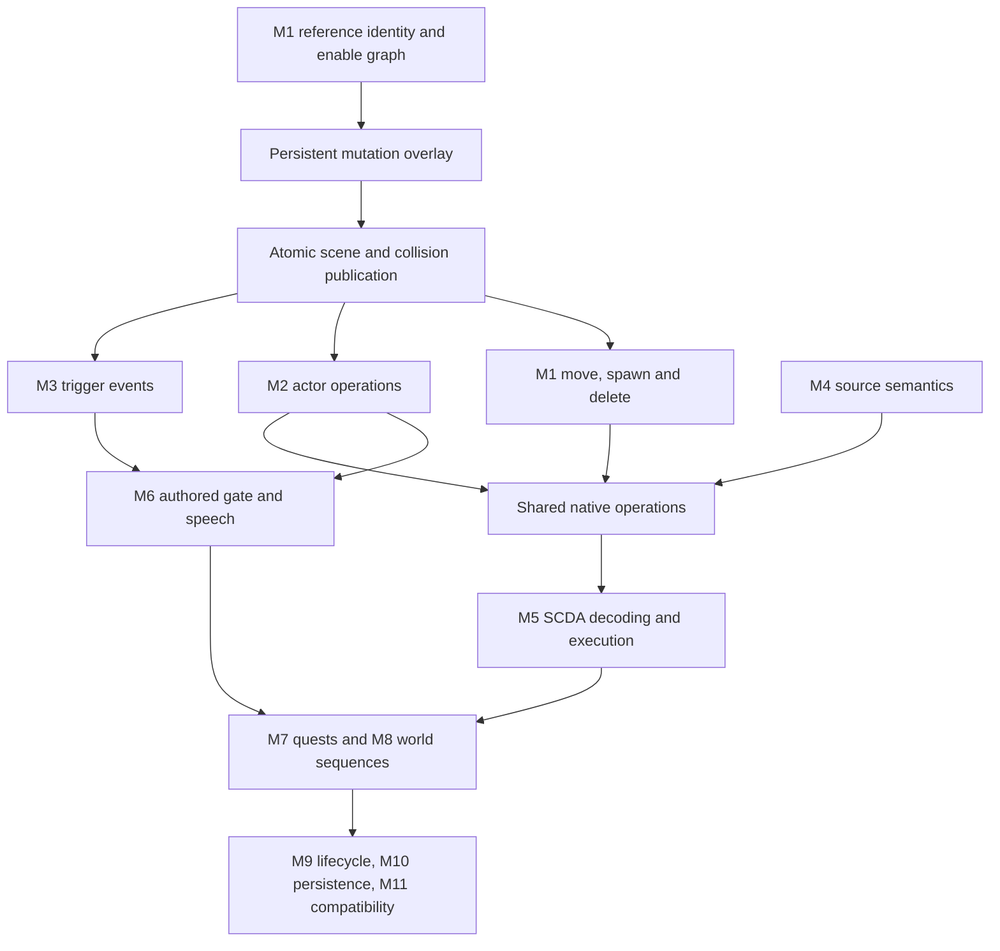

# FalloutQuest scripting completion — recovery status

## Recovery point

- Starting canonical main: `2987d911f318b92d1041257868067851a09d16f0` (v208).
- Resumed from published `6469dbb872889a79a0682501b75f6ac6577ab547`.
- Latest implemented checkpoint: M1B1 persistent enable overlays/snapshots,
  validated locally; publication follows this commit. Version remains v208.

| Checkpoint | Canonical published main commit | Publication |
| --- | --- | --- |
| M0 audit | `a3324a2a104babdf057258e24b41977d88292e3b` | Confirmed |
| M1A queries | `1246a9a23c092e53fb29ee91059ebd826de62745` | Confirmed |
| Previous recovery report | `6469dbb872889a79a0682501b75f6ac6577ab547` | Confirmed |

The user directly confirmed permission to push to main on 2026-10-14. The old
approval blocker is resolved. Command-line Git cannot authenticate for writes;
publication uses the connected GitHub Git-data API. Every published tree was
checked byte-for-byte by Git tree SHA against its tested local checkpoint.
GitHub generates new commit identities; prior local M0/M1A/report SHAs were
2310bbe9028c583053d846bf762039a8ce1d1a1a,
4670209591a3a36b2c2c2caf0847521982988049 and
a8a6a19f7b8a92c67e66c6d1a0a41a030777f6f0 respectively. These are provenance,
not current recovery commits. Fetch and use canonical published main.

- No engine completion claimed.
- This document and `SCRIPTING_ORIGINAL_INVENTORY.json` describe actual support,
  not a promise that all listed functions execute.
- Fetch main and inspect this file and recent commits before resuming. Preserve
  newer work. Commit and push each validated checkpoint on main. No binary assets.

## Original-data inventory

Generate with `python3 tools/scripting/audit_original_scripts.py <Fallout3.esm>
--output docs/SCRIPTING_ORIGINAL_INVENTORY.json`. Input SHA256 is in the JSON.
1,257 SCPTs all contain SCTX and SCDA (413,561 compiled bytes). 573,610 placed
references include 5,502 enable-parent children and 1,763 initially disabled
references. XESP flags observed: 0, 1, 2, 3. No missing parents in the master.

Top source heads across all SCTX containers include Enable (805), Disable (746),
MoveTo (741), PlayGroup (307), StartCombat (296), SayTo (273), PlaceAtMe (269).
These are lexical counts, including result fragments, not compatible-script
counts. `SCRIPTING_NATIVE_COMMANDS.json` extracts 569 contiguous command entries
from the supplied PE32 executable: original names, aliases, opcodes, optional
parameters/type IDs, calling-reference requirement and execute/evaluate addresses.
GetDisabled 0x1023 anchors the table; all opcodes from 0x1000 must be sequential.
MoveTo is the alias of MoveToMarker 0x109E with three optional float offsets.
Delete is not a command name in this table; verify the actual lifecycle operation
before implementation rather than accepting invented syntax.

`SCRIPTING_SCDA_INVENTORY.json` validates instruction envelopes of 8,336 original
SCDA fragments (SCPT and result scripts), with control/native opcode counts.
The dot operator 0x1C carries a reference index instead of a payload length.
This is **not** bytecode execution or validation of expression operands, branch
offsets or native argument serialization. The 40-byte CommandInfo and 12-byte
ParamInfo layout and base opcodes are corroborated by the FOSE source:
https://github.com/c6-dev/ButcherPeteFOSE/blob/master/fose/CommandTable.h
Return types and complete engine semantics still require M5 research.

`SCRIPTING_SOURCE_BASELINE.json` reports 1,252 parsable event programs, 2,053
indexed blocks, and 597 command-compilable blocks using the production compiler.
The owner used for local syntax resolution is synthetic; no corpus blocks are
executed. First-failure buckets are diagnostics, not complete missing-command
counts. The other five scripts fail preamble/event parsing. All SCTX declarations
and CTDA function ID frequencies are in the original-data inventory.

Events include GameMode 524, OnActivate 373, OnTriggerEnter 309, OnDeath 209,
OnLoad 186, SayToDone 128, OnHit 69. Other observed types are in JSON.
OnPackageEnd and OnPackageDone both occur (20 each); do not conflate them.

## Implementation audit

| Area | Actual baseline | Validation / remaining dependency |
| --- | --- | --- |
| QUST results | Ordered QSDT, immediate nested stages, conditions, repeats, journal, distinct completion/running | Existing original MS11 disarm regression; broader real quest corpus needed |
| SCPT / INFO source | Shared guarded command compiler and expression evaluator | Small subset; compilation is not execution compatibility |
| SCDA | SCHR/SCDA/SCRO retained | Not executable; M5 |
| Variables | Numeric locals by owner/index, qualified quest/NPC variables, globals | Float storage; ref locals and integer coercion incomplete; arbitrary reference variable ownership incomplete |
| Expressions | Nested branches, comparisons, AND/OR, unary signs, addition/subtraction, selected queries | No multiplication/division or general function registry; full strings/formatting unsupported |
| Events | Reference OnActivate, weapon OnHit/OnDeath, quest/resident ACTI GameMode | NPC activation uses separate narrow dialogue bridge; most events indexed but undelivered |
| Scheduling | 4 Hz bounded quest/ACTI dispatch on simulation thread | No resident NPC GameMode, trigger/package/effect lifecycle; no PC timing parity claim |
| Actor control | EVP increments package revision; physical damage/death exist | Kill/resurrect/combat/faction/AV/equipment commands mostly missing |
| World control | Lock/unlock through canonical persistent APIs; M1A GetDisabled follows complete original enable-parent chains | M1B1 persists staged enable overlays; script Enable/Disable, move/spawn/delete remain unavailable |
| Scene / streaming | Async geometry/texture/collision preparation, atomic publication, NPC cell handoff | Disabled placements discarded before loading; no script mutation publication or cross-cell reference relocation |
| Audio / UI | Transactional MESG, sounds, Karma and quest notices | Narrow formatting; no Say/SayTo or PlayGroup/IsAnimPlaying scripting interface |
| Persistence | FQPS v14; QST1 globals/running/journal; QNF1 reveal history; locks, XP, actors, inventory, ownership | M1B1 RFE1 root-enable overlay; level allocation absent |
| Transactions | State/revision and pending queues restored on result/stage/event failure and previews | External scene/physics/audio effects must publish only after transaction success |

Read `quest-scripting-checkpoint-{1,2,3}.md` and `bomb-quest-hud-v208.md`
for previous work and deliberate limitations. Preserve existing systems.

## Dependency graph



## Verified integration chains and blockers

- MS11 stage 40 needs MS11DetonatorRef 0001E99F (ACTI 0001E9AA) Enable and
  conditional Burke 00014F77 MoveToMarker. Reject until real scene/actor mutation
  exists. Rigging is not successful merely because a stage can be set.
- Gate trigger: ACTI 000BF788 -> SCPT 000BF78A MegatonGateTriggerSCRIPT.
- Gatehouse: REFR 0001D55A -> ACTI 0001D6AD -> SCPT 0001D6AC.
- Deputy Weld: ACRE 0001FB3A -> CREA 0001FB39 -> SCPT 0001FB3B.
- M3/M6 need authored trigger geometry, reference-local writes, event ordering,
  PlayGroup and speech completion. No custom distance check or gate animation.
  Placed trigger IDs/geometry still need detailed verification.

## Next checkpoints

1. M0/M1A/recovery report are published; verify Android CI for canonical main.
2. M1B1 backend implemented: canonical saved root-enable overrides, graph queries,
   bounded RFE1 validation, owned immutable projections, and regression tests.
   See `world-reference-m1b1.md`. No source Enable/Disable handler exists.
3. M1B2: thread snapshots into scene and streaming workers, interior/exterior
   placements and lights before model/collision preparation. Then M1B3 must
   handle live publication, stale worker/cache invalidation, interaction/physics/
   navigation and actor coordination. Only then admit script mutation commands.
4. M1C+: cross-cell MoveTo/MoveToMarker with original placements/actor handoff,
   spawn identity/lifecycle and Delete; transaction/persistence tests.
5. M2–M11 in task order, subdividing independently testable checkpoints.

## Build and tests

- Host CMake initially missing; installed into task runtime with pip.
- M0 player host build succeeds with -Wall/-Wextra/-Werror; all 27 CTest cases pass.
- Original ESM bomb regression passes activation/cancel/disarm/Karma/notices/save-reload; rigging rejects atomically.
- Production compiler inventory: 597/2,053 event blocks command-compile (not execute).
- SCDA envelope validation: 8,336/8,336 nonempty original fragments; four malformed/boundary Python tests pass.
- Native table extraction: 569 contiguous validated opcode/signature entries.
- Additional host suites now pass: world 5, physics 1, assets 3, NIF 12, audio 2.
- Render C++ checks pass: GL-state cache, opaque timer, render policy, actor skinning,
  notification rendering. Nine source checks pass (eight renderer/UI plus collision).
- Original master XTEL graph passes: 1,118 directed links, reciprocal validation,
  cross-cell/world identities and Megaton room/exterior/shop route.
- M1A original bomb, 5,502 enable-parent queries and Lucas dialogue acceptance/
  stage/save-reload pass; all 27 updated player CTest cases pass.
- Shader compile/link tests not run: glslangValidator absent. Renderer unchanged.
- Android CI is running on published 6469dbb; no final APK result claimed yet.
- Android toolchain absent locally. Existing push workflow provisions Java 17,
  Gradle 8.9, SDK 35, NDK 27, CMake 3.22.1. No Gradle wrapper exists.
- Original master player catalogue/ACHR census/inventory/save-reload regression also passes.
- No physical Quest validation. No CPU/GPU performance measurements.
- Original dependencies supplied: Fallout3.esm, executable, INIs, shader/mesh/
  texture archives and Misc BSA. Inspect original assets as commands need them;
  never add their binaries to GitHub.

## Reproduce this checkpoint

```sh
cmake -S tests/player -B /tmp/fq-player
cmake --build /tmp/fq-player --parallel 4
ctest --test-dir /tmp/fq-player --output-on-failure
/tmp/fq-player/event_script_tests <Fallout3.esm> /tmp/source-inventory.json
/tmp/fq-player/dialogue_tests <Fallout3.esm>
/tmp/fq-player/player_state_tests <Fallout3.esm>
python3 tests/player/test_scripting_audit.py
```

The original-data arguments are mandatory to rerun the 5,502-reference, bomb,
Lucas and real catalogue regressions; plain CTest uses synthetic fixtures.
Additional host suites use the same configure/build/ctest pattern for world,
physics, assets, nif and audio. Original XTEL validation takes the master path
as the first argument to `xtel_index_tests`. No original game assets are stored
in the repository or reports. All reports contain metadata, never binary code.

## M1B1 validation

All 27 player host cases pass. Original ESM root/inverted-child changes and
save/reload pass. RFE1 malformed-state tests retain live state/revisions; legacy
save fixtures remain unchanged. No script mutations or headset validation yet.
