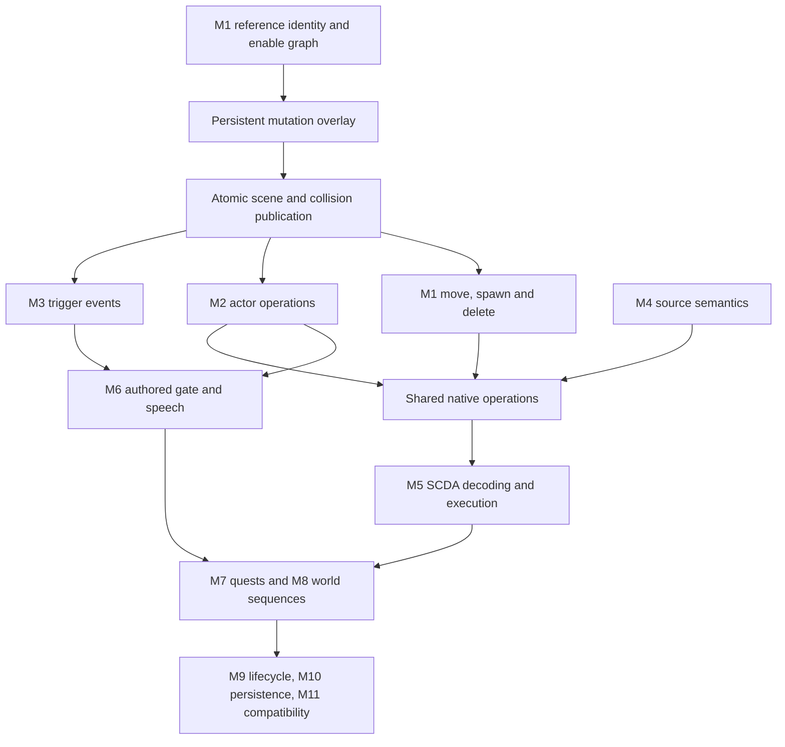

# FalloutQuest scripting completion — recovery status

## Recovery point

- Starting canonical main: `2987d911f318b92d1041257868067851a09d16f0` (v208).
- Resumed from published `6469dbb872889a79a0682501b75f6ac6577ab547`.
- Current implementation checkpoint: M1B3n guarded reference/cache publication.
  Use canonical main history for the publication SHA; the previous published
  resource implementation is M1B3m `1543fa28a4bd69c5fca72e4051598d93a3b8e6c2`.
- M1B3l Android CI succeeded: https://github.com/dwalton29/FalloutQuest/actions/runs/38635385905.
- M1B3m Android CI succeeded: https://github.com/dwalton29/FalloutQuest/actions/runs/38793178567.
  Earlier M1B3h CI confirmed the collision-policy include-order failure from g is fixed.
- Re-fetched and preserved newer canonical v210 barter, v211 MS11 completion and
  v212 Moira fixes. Current baseline `5a4ad709d43d36ec756aaa48bae441e45f400db7`
  is 212 / 0.74.1-moira-barter; its Android CI succeeded (run 38647849567).
  v211 admits a separate bounded nonresident actor Disable path through dialogue;
  general resident Enable/Disable remains unfinished. Older checkpoint statements
  below describe their historical boundary, not removal of that v211 support.
- M1B2 scene-load/stream-in integration is host-validated and pushed; the remote
  tree matches the tested tree `20c0e9cd4d5206190925d30a68408400c6fb1923`. Newer v209 is preserved: 209 / 0.72.0-persistent-player-stats.

| Checkpoint | Canonical published main commit | Publication |
| --- | --- | --- |
| M0 audit | `a3324a2a104babdf057258e24b41977d88292e3b` | Confirmed |
| M1A queries | `1246a9a23c092e53fb29ee91059ebd826de62745` | Confirmed |
| Previous recovery report | `6469dbb872889a79a0682501b75f6ac6577ab547` | Confirmed |
| M1B1 overlays/snapshots | `5f99428df64c8df1fa62c625bfc5c08461c1f5e2` | Confirmed |
| Concurrent player stats v209 | `377b5be0251be3bf9e78efd6055325aa2e2b3a8d` | Preserved |
| v209 compatibility | `29a0c614313b948a70508aab1213204e8117d153` and `fe798c051a41648c46b9e300d6949da8da71838c` | Preserved |
| M1B2 scene/streaming snapshots | `aa8ba6d56c4eda4e39fdb92e3c6d591a8ef63268` | Confirmed |
| M1B3a scene publication admission | `86ddd9c407482207aab7799760259a8f643dfcd6` | Confirmed |
| M1B3b reversible collision exchange | `61d1481b8a9bd75a78dc1ea37192da1fc2a6665b` | Confirmed |
| M1B3c detached reference plans | `0e9dd258701f9aca48de66acae3994129d20c6d3` | Confirmed |
| M1B3d whole-script candidates | `bff707b126122bb9853f855fc7ba72e65f82722f` | Confirmed |
| M1B3e empty collision worlds | `fb8e4024a53cc3d265bed752929d9c9f22dbab62` | Confirmed |
| M1B3f visual ownership exchange | `5fe5c76d72eb09869df8f479df6781a4f6bd83ba` | Confirmed |
| M1B3g candidate CPU resources | `ecbd98b85fd3c8979022c2b563f8aa3b6663de5a` | Confirmed; Android include fix in h |
| M1B3h private texture/GPU preparation | `25a7be3006e5eb2b16eaf6d48ffb9319b4f95f71` | Confirmed |
| M1B3i reserved resident asset lane | `b57842aeb7e39c34f182f6debc3e44efd6146196` | Confirmed |
| M1B3j private collision resources | `98ad9cbd3e4c0ece6188e2108f3e76a391772f65` | Confirmed |
| M1B3k reversible interior lights | `7f97e3f062609847e972cdf34f32133896410028` | Confirmed |
| M1B3l reversible interior load doors | `b91803140f957935c3e1ede182f6dcddd5affb8a` | Confirmed |
| M1B3m read-only interaction preflight | `1543fa28a4bd69c5fca72e4051598d93a3b8e6c2` | Confirmed |

The user directly confirmed permission to push to main on 2026-10-14. The old
approval blocker is resolved. Command-line Git cannot authenticate for writes;
publication uses the connected GitHub Git-data API. Every published tree was
checked byte-for-byte by Git tree SHA against its tested local checkpoint.
GitHub generates new commit identities; prior local M0/M1A/report SHAs were
2310bbe9028c583053d846bf762039a8ce1d1a1a,
4670209591a3a36b2c2c2caf0847521982988049 and
a8a6a19f7b8a92c67e66c6d1a0a41a030777f6f0 respectively. These are provenance,
not current recovery commits. Fetch and use canonical published main.

- No engine completion claimed.
- This document and `SCRIPTING_ORIGINAL_INVENTORY.json` describe actual support,
  not a promise that all listed functions execute.
- Fetch main and inspect this file and recent commits before resuming. Preserve
  newer work. Commit and push each validated checkpoint on main. No binary assets.

## Original-data inventory

Generate with `python3 tools/scripting/audit_original_scripts.py <Fallout3.esm>
--output docs/SCRIPTING_ORIGINAL_INVENTORY.json`. Input SHA256 is in the JSON.
1,257 SCPTs all contain SCTX and SCDA (413,561 compiled bytes). 573,610 placed
references include 5,502 enable-parent children and 1,763 initially disabled
references. XESP flags observed: 0, 1, 2, 3. No missing parents in the master.

Top source heads across all SCTX containers include Enable (805), Disable (746),
MoveTo (741), PlayGroup (307), StartCombat (296), SayTo (273), PlaceAtMe (269).
These are lexical counts, including result fragments, not compatible-script
counts. `SCRIPTING_NATIVE_COMMANDS.json` extracts 569 contiguous command entries
from the supplied PE32 executable: original names, aliases, opcodes, optional
parameters/type IDs, calling-reference requirement and execute/evaluate addresses.
GetDisabled 0x1023 anchors the table; all opcodes from 0x1000 must be sequential.
MoveTo is the alias of MoveToMarker 0x109E with three optional float offsets.
Delete is not a command name in this table; verify the actual lifecycle operation
before implementation rather than accepting invented syntax.

`SCRIPTING_SCDA_INVENTORY.json` validates instruction envelopes of 8,336 original
SCDA fragments (SCPT and result scripts), with control/native opcode counts.
The dot operator 0x1C carries a reference index instead of a payload length.
This is **not** bytecode execution or validation of expression operands, branch
offsets or native argument serialization. The 40-byte CommandInfo and 12-byte
ParamInfo layout and base opcodes are corroborated by the FOSE source:
https://github.com/c6-dev/ButcherPeteFOSE/blob/master/fose/CommandTable.h
Return types and complete engine semantics still require M5 research.

`SCRIPTING_SOURCE_BASELINE.json` reports 1,252 parsable event programs, 2,053
indexed blocks, and 597 command-compilable blocks using the production compiler.
The owner used for local syntax resolution is synthetic; no corpus blocks are
executed. First-failure buckets are diagnostics, not complete missing-command
counts. The other five scripts fail preamble/event parsing. All SCTX declarations
and CTDA function ID frequencies are in the original-data inventory.

Events include GameMode 524, OnActivate 373, OnTriggerEnter 309, OnDeath 209,
OnLoad 186, SayToDone 128, OnHit 69. Other observed types are in JSON.
OnPackageEnd and OnPackageDone both occur (20 each); do not conflate them.

## Implementation audit

| Area | Actual baseline | Validation / remaining dependency |
| --- | --- | --- |
| QUST results | Ordered QSDT, immediate nested stages, conditions, repeats, journal, distinct completion/running | Existing original MS11 disarm regression; broader real quest corpus needed |
| SCPT / INFO source | Shared guarded command compiler and expression evaluator | Small subset; compilation is not execution compatibility |
| SCDA | SCHR/SCDA/SCRO retained | Not executable; M5 |
| Variables | Numeric locals by owner/index, qualified quest/NPC variables, globals | Float storage; ref locals and integer coercion incomplete; arbitrary reference variable ownership incomplete |
| Expressions | Nested branches, comparisons, AND/OR, unary signs, addition/subtraction, selected queries | No multiplication/division or general function registry; full strings/formatting unsupported |
| Events | Reference OnActivate, weapon OnHit/OnDeath, quest/resident ACTI GameMode | NPC activation uses separate narrow dialogue bridge; most events indexed but undelivered |
| Scheduling | 4 Hz bounded quest/ACTI dispatch on simulation thread | No resident NPC GameMode, trigger/package/effect lifecycle; no PC timing parity claim |
| Actor control | EVP increments package revision; physical damage/death exist | Kill/resurrect/combat/faction/AV/equipment commands mostly missing |
| World control | Lock/unlock through canonical persistent APIs; M1A GetDisabled follows complete original enable-parent chains; v211 bounded off-scene actor Disable through dialogue transactions | M1B1 persists staged enable overlays; general resident Enable/Disable, move/spawn/delete remain unavailable |
| Scene / streaming | Async geometry/texture/collision preparation, atomic publication, NPC cell handoff | Saved enable state now selects placements/lights/collision inputs on scene load and stream-in; live script mutation publication and cross-cell relocation remain unfinished |
| Audio / UI | Transactional MESG, sounds, Karma and quest notices | Narrow formatting; no Say/SayTo or PlayGroup/IsAnimPlaying scripting interface |
| Persistence | FQPS v14 for unchanged attributes, v15 with RFE1/PST1 for attribute overrides; QST1 globals/running/journal; QNF1 reveal history; locks, XP, actors, inventory, ownership | M1B1 RFE1 root-enable overlay; level allocation absent |
| Transactions | Result/stage/event execution and const previews evaluate private candidates; guarded allocation-free publication/rollback includes saved state, buttons and queued effects | Resident scene/physics/actor coordinator remains unfinished; delivered effects forbid rollback |

Read `quest-scripting-checkpoint-{1,2,3}.md` and `bomb-quest-hud-v208.md`
for previous work and deliberate limitations. Preserve existing systems.

## Dependency graph



## Verified integration chains and blockers

- MS11 stage 40 needs MS11DetonatorRef 0001E99F (ACTI 0001E9AA) Enable and
  conditional Burke 00014F77 MoveToMarker. Reject until real scene/actor mutation
  exists. Rigging is not successful merely because a stage can be set.
- Gate trigger: ACTI 000BF788 -> SCPT 000BF78A MegatonGateTriggerSCRIPT.
- Gatehouse: REFR 0001D55A -> ACTI 0001D6AD -> SCPT 0001D6AC.
- Deputy Weld: ACRE 0001FB3A -> CREA 0001FB39 -> SCPT 0001FB3B.
- M3/M6 need authored trigger geometry, reference-local writes, event ordering,
  PlayGroup and speech completion. No custom distance check or gate animation.
  Placed trigger IDs/geometry still need detailed verification.

## Next checkpoints

1. M0/M1A/M1B1/M1B2 are published; verify the current Android CI result below.
2. M1B1 backend implemented: canonical saved root-enable overrides, graph queries,
   bounded RFE1 validation, owned immutable projections, and regression tests.
   See `world-reference-m1b1.md`. M1B1 does not itself admit world commands;
   v211's separate bounded nonresident actor Disable path is preserved.
3. M1B2 implemented and validated: saved snapshots feed scene/stream-in
   placements, lights, collision inputs and canonical interaction permissions.
   See `world-reference-m1b2.md`. The **first unfinished implementation is M1B3**:
   resident outer-transaction/resource coordinator and actor/held-object/
   navigation coordination. M1B3a adds stale-work admission; M1B3b adds reversible
   collision; M1B3c adds detached reference plans; M1B3d stages whole-script state
   and queued effects (see `world-reference-m1b3d.md`); M1B3e supports empty
   collision mutations and queries (see `world-reference-m1b3e.md`); M1B3f adds
   reversible visual ownership and cache/lifetime guards (see `world-reference-m1b3f.md`).
   M1B3g adds immutable placement deltas and strict incoming CPU resource packets
   (see `world-reference-m1b3g.md`). M1B3h adds strict named-texture decode, private
   GPU staging and transfer to a reversible visual plan (see `world-reference-m1b3h.md`).
   M1B3i reserves the asset lane, drains running jobs, parks ordinary consumers and
   owns cancellable CPU preparation through ticketed GPU staging (see `world-reference-m1b3i.md`).
   M1B3j adds strict private collision chunks, policy exchange and owned collision
   tokens to the worker/GPU packet (see `world-reference-m1b3j.md`).
   M1B3k adds strict interior point-light projections, coupled reversible light
   resources and cache epochs (see `world-reference-m1b3k.md`).
   M1B3l couples authored interior XTEL targeting anchors with prompt metadata/text,
   immutable worker preparation and reversible cache ownership (see `world-reference-m1b3l.md`).
   M1B3m adds read-only interaction/dynamic-state admission before worker/GPU work
   and resource commits (see `world-reference-m1b3m.md`).
   M1B3n couples reference publication and its renderer cache with precomputed
   monotonic rollback projections (see `world-reference-m1b3n.md`).
   Exterior lights, remaining interaction ownership, queue reconciliation and the
   outer runtime/resource/actor coordinator remain unfinished. Only then admit
   general resident Enable/Disable; no success-only handlers are allowed.
4. M1C+: cross-cell MoveTo/MoveToMarker with original placements/actor handoff,
   spawn identity/lifecycle and Delete; transaction/persistence tests.
5. M2–M11 in task order, subdividing independently testable checkpoints.

## Build and tests

- Host CMake initially missing; installed into task runtime with pip.
- M0 player host build succeeds with -Wall/-Wextra/-Werror; all 27 CTest cases pass.
- Original ESM bomb regression passes activation/cancel/disarm/Karma/notices/save-reload; rigging rejects atomically.
- Production compiler inventory: 597/2,053 event blocks command-compile (not execute).
- SCDA envelope validation: 8,336/8,336 nonempty original fragments; four malformed/boundary Python tests pass.
- Native table extraction: 569 contiguous validated opcode/signature entries.
- Additional host suites now pass: world 6, physics 1, assets 3, NIF 12, audio 2.
- Render C++ checks pass: GL-state cache, opaque timer, render policy, actor skinning,
  notification rendering. Nine source checks pass (eight renderer/UI plus collision).
- Original master XTEL graph passes: 1,118 directed links, reciprocal validation,
  cross-cell/world identities and Megaton room/exterior/shop route.
- M1A original bomb, 5,502 enable-parent queries and Lucas dialogue acceptance/
  stage/save-reload pass; all 27 updated player CTest cases pass.
- Shader compile/link tests not run: glslangValidator absent. Renderer unchanged.
- Published M0/M1A/recovery Android workflows succeeded, including complete
  shader/render checks, host suites, native APK compilation and artifact upload.
  Recovery run: https://github.com/dwalton29/FalloutQuest/actions/runs/38602460533
- M1B1 Android workflow succeeded, including APK/artifact upload (run 38604051145).
- Incoming v209 CI failed nine synthetic save tests; merged fixtures/offsets and
  legacy resource-bound fixes now pass all 27 player tests locally. The combined
  M1B2/v209 checkpoint is pushed. Its Android workflow is in progress:
  https://github.com/dwalton29/FalloutQuest/actions/runs/38610318566
  The preceding v209 legacy compatibility build (fe798c0) succeeded.
- Android toolchain absent locally. Existing push workflow provisions Java 17,
  Gradle 8.9, SDK 35, NDK 27, CMake 3.22.1. No Gradle wrapper exists.
- Original master player catalogue/ACHR census/inventory/save-reload regression also passes.
- No physical Quest validation. No CPU/GPU performance measurements.
- Original dependencies supplied: Fallout3.esm, executable, INIs, shader/mesh/
  texture archives and Misc BSA. Inspect original assets as commands need them;
  never add their binaries to GitHub.

## Reproduce this checkpoint

```sh
cmake -S tests/player -B /tmp/fq-player
cmake --build /tmp/fq-player --parallel 4
ctest --test-dir /tmp/fq-player --output-on-failure
/tmp/fq-player/event_script_tests <Fallout3.esm> /tmp/source-inventory.json
/tmp/fq-player/dialogue_tests <Fallout3.esm>
/tmp/fq-player/player_state_tests <Fallout3.esm>
python3 tests/player/test_scripting_audit.py
```

The original-data arguments are mandatory to rerun the 5,502-reference, bomb,
Lucas and real catalogue regressions; plain CTest uses synthetic fixtures.
Additional host suites use the same configure/build/ctest pattern for world,
physics, assets, nif and audio. Original XTEL validation takes the master path
as the first argument to `xtel_index_tests`. No original game assets are stored
in the repository or reports. All reports contain metadata, never binary code.

## M1B1 validation

All 27 player host cases pass. Original ESM root/inverted-child changes and
save/reload pass. RFE1 malformed-state tests retain live state/revisions; legacy
save fixtures remain unchanged. No script mutations or headset validation yet.

## M1B2 validation and next recovery step

51 host cases pass. Original event/bomb, catalogue/census, Lucas/MS11 dialogue,
ownership and lockpick regressions pass. Production placement selection validates
original Tenpenny detonator identity/model/pose and collision input. Concurrent
snapshot fixtures and saved-state interaction/light tests pass. Native/headset
validation of the current integration must not be inferred from these tests.

The legacy Wasteland gate suppression and missing ACRE/ACTI qualified-variable
ownership are additional M3/M4/M6 blockers; see `world-reference-m1b2.md`.

## Concurrent-main recovery

Publication of the pre-v209 M1B2 tree was rejected by the expected-head lease.
Fetched and preserved 377b5be0251be3bf9e78efd6055325aa2e2b3a8d, replayed the
scene changes, and validated RFE1/PST1 coexistence plus all legacy migrations.
The old local b605ec8ed591c4e5efb0a53f94a618b043683eeb is superseded and was
never published. Do not reset main to it. The current M1B2 checkpoint is based on
v209, not the earlier v208 tree.

The subsequent fe798c0 (v209 legacy zero-health compatibility) follow-up also landed
before publication. Its conditional format policy is preserved: unchanged
characters still write v14; attribute overrides write v15 with RFE1/PST1. The
superseded local 37582503d72231d7e8b3d8768dde2a89bf9c1cfb was not published.

## Published M1B2 recovery point

All 27 player and six world cases pass after replay onto canonical fe798c0.
Original master event/bomb, player/census/save, Lucas/MS11 dialogue, ownership,
lockpick and Tenpenny detonator placement regressions were rerun successfully.
All existing version 209 changes are retained. No new script command is admitted
by M1B2; GetDisabled remains the M1 query implementation.

Next is M1B3: resident-resource preflight and an outer-transaction publication
coordinator, reversible collision/physics/navigation, stale CELL/metadata/cache
invalidation and actor lifecycle coordination. Merely adding a revision check
to completed workers is insufficient: staged GPU uploads, reused CELL metadata
and collision snapshots also need the same publication epoch. Existing CELL
reset seeds the old visible window as ready, so it cannot be reused blindly as
a live state refresh. Enable/Disable must remain unavailable until these paths
are coordinated and tested. No physical Quest or frame-time validation yet.

## M1B3a continuation (2026-10-14)

Implemented scene publication stamps separating the live-player projection from
the successfully published scene. CELL workers, reused metadata, GPU slices,
collision snapshots and NPC arrivals now reject stale scene/reference identities.
Same-CELL reloads invalidate old work even when origin/revision are unchanged.
Staged resources are retired before CELL metadata reset. Uncoordinated live-state
changes stop streaming admission rather than marking the old scene ready under
a new revision. Rollback requeues discarded work safely.

See `world-reference-m1b3a.md` for implementation, validation and exact boundary.
Host result: 49 passed, two asset-dependent NIF cases skipped, zero failures.
This corrects earlier wording which counted 51 registered cases as all passed.
Scene/publication and NPC ordering source checks pass. Android runtime compilation
and headset tests remain outstanding. No source Enable/Disable commands admitted;
no version change. First unfinished M1B3 work is still the resident outer-transaction
coordinator and reversible collision/physics/navigation plus actor/held-object
coordination. Stale-work rejection alone is not live world mutation support.

M1B3a follow-up retains the complete requested NPC arrival ID set while workers
run. Stale/partially failed preparation therefore requeues all requested actors,
including those for which no visual was produced. This avoids losing an arrival
when its old preparation is discarded. Source-ordering checks pass after the fix.

## M1B3b — reversible collision dependency (2026-10-14)

Continues canonical f6068e57afa335638246089ef0a765b8c9c89ff0. Added owned
collision mutation inputs, prebuilt collision/query structures and reversible
render-thread exchanges retaining the exact displaced world. Scene, door and
collected-reference changes reject stale candidates/rollbacks. Current rotated
and nonsolid animated doors survive candidate preparation. See
`world-reference-m1b3b.md` for API ownership, validation and limitations.

34 relevant host cases pass (physics 1, world 6, player 27), plus original Common
House geometry removal/rollback and ASan/UBSan synthetic/original checks. Exchange
and rollback succeed while allocations are prohibited. The archive fixture has
335 input placements, 77 available decoded placements and 1,715 triangles; missing
models make it a partial original-data check. No Android/headset result claimed.

No source Enable/Disable handler or version bump. Empty/fully filtered worlds
still fail preflight pending query semantics; capped exterior candidates reject
atomically. The first unfinished integration remains the resident outer-transaction
coordinator across save/script effects, visuals, collision/navigation, actors and
held/loose objects. This new collision primitive is not yet invoked by scripts.

M1B3b published implementation 61d1481b8a9bd75a78dc1ea37192da1fc2a6665b
was fetched and its complete tree verified against the tested local tree
726f76760c75ea054bf3ddb689bedf0d4474de67. Android workflow 38614606380
is in progress; native completion and headset results are not inferred. The
original archive/ESM manifest export helper is committed under tools/physics.

## M1B3c — detached reference-state planning (2026-10-14)

Continues canonical main 30e18f9219748b2d9133b0824b8d9a1f097fd99e. Owned
reference plans validate whole ordered batches without live staging, precompute
immutable candidate/rollback projections and list all effective descendant/root
changes. Revision/session-bound map commits and immediate rollbacks allocate
nothing. Rollback advances revisions, so older plans/work are not re-admitted.
See `world-reference-m1b3c.md` for the conservative full-Player revision guard,
snapshot ownership and coordinator contract. No script handler is admitted.

Validation: full rebuilt player suite 28, world six and collision one pass (35
host cases); scene/epoch/NPC publication source checks pass. New plan tests cover
unchanged save bytes during preparation, cancelled/invalid/no-op batches, exact
descendant lists, stale plans/rollback, session/address reuse, save/reload and
allocation-free commit/rollback. ASan/UBSan plan tests pass with LeakSanitizer
disabled due the environment. Original ESM projection/commit/rollback checks all
5,502 XESP children, plus bomb activation/cancel/disarm/Karma/notices/persistence
and Lucas/MS11 dialogue acceptance/save. Corpus command compilation remains
597/2,053 indexed event blocks, not execution coverage.

This is a reference-only payload. Complete script state/effect-queue candidates,
resident GPU/interaction publication, actor/held-object/navigation coordination
and empty-world collision query semantics remain unfinished. The new methods
are not invoked by any source handler or runtime render path. Preserve all M1B3a
admission and M1B3b exchange guards while integrating the real coordinator.
Version/schema remain unchanged. Android/headset validation is outstanding;
check the latest main workflow after publication.

## M1B3d validation

Whole-script candidate transactions pass all 29 rebuilt player cases, six world
cases and one collision case (36 total). Original bomb/event, 5,502-child enable
graph, Lucas/MS11 dialogue and catalogue/census/save regressions pass. The two
plan suites pass ASan/UBSan with LeakSanitizer disabled for this traced runtime.
Scene publication source checks and four scripting audit tests pass. See
`world-reference-m1b3d.md` for the remaining resident coordinator boundary.

## M1B3e validation

Rebuilt collision tests, six world and 29 player cases pass (36 total). Empty
interior/exterior queries, re-enable, stale-token rejection and allocation-free
exchange/rollback pass. Original Common House whole-world removal/restoration
retains all 1,715 fixture triangles and the exact prior buffers. Synthetic and
original collision cases pass ASan/UBSan with LeakSanitizer disabled. See
`world-reference-m1b3e.md` for query behavior and the remaining coordinator.

## M1B3f validation

Reversible visual ownership passes seven rebuilt world cases, 29 player and one
physics case (37 total), plus ASan/UBSan ownership tests (LeakSanitizer disabled).
Allocation-failure and shared/unique-resource lifetime tests pass. Production
scene/CELL/teardown epoch ordering and cache invalidation source checks pass,
along with opaque/LOD/dispatch checks and C++ GL-cache/reflection policy tests.
Actual native GL/headset validation remains separate. See `world-reference-m1b3f.md`;
the full candidate resource/actor/held-object coordinator is still unfinished.

## M1B3g validation

Candidate placement/CPU preparation passes eight world, 29 player and one physics
case (38 core host cases). Ten NIF no-argument cases pass; three original-data
cases skip in bare CTest. Original MS11 detonator planning and the separate Common
House multi-part NIF/CPU test pass, including rejection of in-memory partial
geometry corruption. Selector/placement and original ESM/NIF cases pass ASan/UBSan
with LeakSanitizer disabled. Relevant scene/CPU/opaque/dispatch source checks pass.
See `world-reference-m1b3g.md`; no candidate GPU publication or world-command
admission is claimed. Continue with texture/GPU staging and the scheduler/outer
coordinator, preserving the fixed scene origin and explicit current residency scope.


## M1B3h validation

Private texture/GPU preparation passes nine world, 29 player and one physics
case (39 core host cases), including the previous Android include-order failure
as a real collision-TU regression. Production image/cube upload helpers pass
recorded GL failure injection and lease/partial-upload/exchange lifetime tests.
The new case passes ASan/UBSan with LeakSanitizer disabled. Source guards verify
worker-only decode, captured publication/visual stamps, isolated texture uploads,
door-prompt suppression and disposal before context caches. Relevant existing
body/Pip-Boy/inventory/skin/opaque/dispatch checks pass. No physical Quest or
performance claim is made. See `world-reference-m1b3h.md`; scheduling and the
outer collision/light/interaction/actor/held-object/navigation/LOD coordinator
remain unfinished, and source world mutation commands remain blocked.


## M1B3i validation

The reserved asset lane passes ten world, 29 player and one physics CTest cases
(40 core host cases). It tests six-family activity drain, owner/stale-ticket
checks, complete result transfer and allocation failure, nonblocking cooperative
cancellation, finish races, teardown joins and exhausted ticket rejection. Lane,
scene preparation, visual exchange and private GPU tests pass ASan/UBSan with
LeakSanitizer disabled. Source checks verify real scheduler gates, read-only
readiness probes, immutable worker captures, ticketed GPU admission and release/
cancellation/context-teardown order. Existing body/Pip-Boy/inventory/skin/opaque/
render-dispatch/LOD checks pass. See `world-reference-m1b3i.md`; the outer
collision/light/interaction/actor/held-object/navigation/LOD transaction and
post-publication queue reconciliation remain unfinished. Enable/Disable remain
rejected, and no Quest performance claim is made.


## M1B3j validation

Private candidate collision/policy preparation passes the 40 core host cases,
including real collision-runtime cache isolation, complete shape-chain rejection,
private model deduplication, empty/absent collision resources, cancellation and
allocation-free policy/world exchange, rollback and reapply. Worker cancellation
releases its prepared token. Original Common House available-source preparation
retains all 1,715 collision triangles and restores exact prior buffers; the full
335-reference request rejects because 239 sources are absent from the supplied
archive. Synthetic/original physics cases pass ASan/UBSan (LeakSanitizer disabled).
Source guards verify private policy/chunks, explicit separate collision scope,
render-thread state capture and token validation before GPU work. See
`world-reference-m1b3j.md`; lighting/interaction/actor/held-object/navigation/LOD
admission and the final logical/resource publication/queue reconciliation remain
unfinished. World commands remain rejected; v209 is preserved.


## M1B3k validation

Reversible interior light resources pass eleven world, 29 player and one physics
CTest cases (41 core host cases). Tests cover strict original point-light
projection, unchanged environment/image-space metadata, malformed/unsupported
inputs and coupled resource ownership with allocation-free commit/rollback.
Original Brass Lantern/Player House 11-to-10 light projections pass; existing
SuperDuperMart template checks remain valid. Interior/resource/lane/GPU tests
and original ESM checks pass ASan/UBSan with LeakSanitizer disabled. Source
checks verify worker isolation, resource cleanup and static/actor/reflection
light cache epochs. The local shader compile subtest is unavailable because
this runtime lacks glslangValidator; CI performs it. See
`world-reference-m1b3k.md`; exterior light changes, interaction/actor/held-object/
navigation/LOD admission and the final logical/resource/queue coordinator remain
unfinished. World commands remain rejected; v209 is unchanged.


## M1B3l validation

Reversible interior load-door resources pass twelve world, 29 player and one
physics CTest cases (42 core host cases). Targeting anchors, prompt metadata and
original FULL bytes share one bundle/epoch; unchanged out-of-scope cache entries
survive preparation. Tests cover enable-parent projections including presentation
and inverted flags, model-free authored targeting, missing/malformed sources,
undeclared deltas, cancellation, stale cache writes and allocation failure.
Commit/rollback allocate nothing and restore exact previous anchor buffers and
prompt nodes. Original Brass Lantern 1-to-0-to-1 load-door exchange/rollback passes,
also under ASan/UBSan with LeakSanitizer disabled. Source guards verify real
legacy-cache aliases and mutation epochs, immutable captures, GPU admission,
asset-ticket guards and teardown/cancellation order. Existing rendering/body/
Pip-Boy/inventory/skin source checks pass. See `world-reference-m1b3l.md`.

This owns interior authored XTEL resources only. Local swing-door poses, active
interaction/loot/lock UI, actors, held/loose objects, navigation, exterior light/
interaction scope, baked LOD admission and final canonical/resource publication
with queue reconciliation still need coordination. World commands remain
rejected; v209 is unchanged. No physical Quest/performance claim is made.

## M1B3m validation

Continues newer v212 main, preserving original barter/Moira and MS11 reward
changes and v211's bounded nonresident actor Disable path. Read-only resident
interaction admission passes thirteen world, 31 player and one physics CTest
cases (45 core host cases). The actual runtime probe covers UI focus, weapon/
shoulder handling, original/live actors, held/loose/collected references, local
doors and furniture without clearing their state. Pure tests cover malformed
scopes, wrong tickets, owned affected lists, late hazards, allocation failure
and allocation-free rechecks. Resource rollback remains available while busy.
Pure admission/resource/lane/GPU/door tests pass ASan/UBSan with LeakSanitizer
disabled; original Brass Lantern door regression and relevant source checks pass.
See `world-reference-m1b3m.md`.

This is conservative admission, not ownership of UI, actors, local doors, held
objects or navigation. General resident Enable/Disable and final canonical/
resource publication, effect/save/simulation exclusion and queue reconciliation
remain unfinished. v212 is unchanged; no physical Quest/performance claim.

## M1B3n validation

Guarded reference publication/cache ownership passes fourteen world, 31 player
and one physics CTest cases (46 core host cases). Tests cover exact snapshot,
cache-owner and publisher identity, stale same-CELL publication, monotonic
rollback, allocation failure, allocation-free exchange and serial exhaustion.
Canonical whole-script tests restore inventory, quest state and queued effects
alongside the correct rollback projection, both before and after candidate
reference publication. Old worker stamps reject after either rollback path.
Source checks cover immutable rollback capture, final handoff and lane guards.
Pure publication tests and canonical whole-script publication/rollback tests pass
ASan/UBSan with LeakSanitizer disabled. The original Lucas/nonresident/barter
production dialogue bridge regression also passes.
See `world-reference-m1b3n.md`. No resident command caller was added; v212 and
its bounded nonresident actor-removal path remain unchanged. The outer atomic
canonical/resource transaction, exclusion, navigation and queue reconciliation
are still unfinished.
