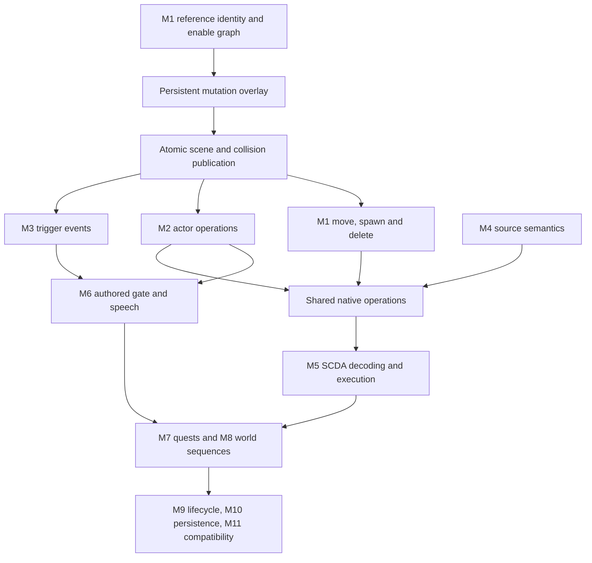

# FalloutQuest scripting completion — recovery status

## Recovery point

- Starting canonical main: `2987d911f318b92d1041257868067851a09d16f0` (v208).
- Resumed from published `6469dbb872889a79a0682501b75f6ac6577ab547`.
- Current implementation checkpoint: M1B3at condition global identities/defaults.
  Use canonical main history for the publication SHA; the previous published
  implementation is M1B3as `059dc2c78a54f5918dd4914b0efb6de0e08bd5d3`.
  M1B3ar Android CI passed (run 39083636186), as did M1B3aq (run 39081584682).
- M1B3l Android CI succeeded: https://github.com/dwalton29/FalloutQuest/actions/runs/38635385905.
- M1B3m Android CI succeeded: https://github.com/dwalton29/FalloutQuest/actions/runs/38793178567.
- M1B3n Android CI succeeded: https://github.com/dwalton29/FalloutQuest/actions/runs/38795209693.
- M1B3o Android CI succeeded: https://github.com/dwalton29/FalloutQuest/actions/runs/38797477661.
- M1B3p Android CI succeeded: https://github.com/dwalton29/FalloutQuest/actions/runs/38799323481.
- M1B3q Android CI failed a libc++ unique_ptr-dereference noexcept assertion
  (run 38801413322). The signature-only fix above is published; CI revalidation
  succeeded at https://github.com/dwalton29/FalloutQuest/actions/runs/38803682541.
  M1B3r Android CI also succeeded (run 38804214979).
  M1B3s Android CI succeeded (run 38906603237).
  M1B3t Android CI succeeded (run 38908824693).
  M1B3u Android CI succeeded (run 38910728273).
  M1B3v Android CI succeeded (run 38912030225).
  Earlier M1B3h CI confirmed the collision-policy include-order failure from g is fixed.
- Re-fetched and preserved newer canonical v210 barter, v211 MS11 completion and
  v212 Moira fixes. Current baseline `5a4ad709d43d36ec756aaa48bae441e45f400db7`
  is 212 / 0.74.1-moira-barter; its Android CI succeeded (run 38647849567).
  v211 admits a separate bounded nonresident actor Disable path through dialogue;
  general resident Enable/Disable remains unfinished. Older checkpoint statements
  below describe their historical boundary, not removal of that v211 support.
- M1B2 scene-load/stream-in integration is host-validated and pushed; the remote
  tree matches the tested tree `20c0e9cd4d5206190925d30a68408400c6fb1923`. Newer v209 is preserved: 209 / 0.72.0-persistent-player-stats.

| Checkpoint | Canonical published main commit | Publication |
| --- | --- | --- |
| M0 audit | `a3324a2a104babdf057258e24b41977d88292e3b` | Confirmed |
| M1A queries | `1246a9a23c092e53fb29ee91059ebd826de62745` | Confirmed |
| Previous recovery report | `6469dbb872889a79a0682501b75f6ac6577ab547` | Confirmed |
| M1B1 overlays/snapshots | `5f99428df64c8df1fa62c625bfc5c08461c1f5e2` | Confirmed |
| Concurrent player stats v209 | `377b5be0251be3bf9e78efd6055325aa2e2b3a8d` | Preserved |
| v209 compatibility | `29a0c614313b948a70508aab1213204e8117d153` and `fe798c051a41648c46b9e300d6949da8da71838c` | Preserved |
| M1B2 scene/streaming snapshots | `aa8ba6d56c4eda4e39fdb92e3c6d591a8ef63268` | Confirmed |
| M1B3a scene publication admission | `86ddd9c407482207aab7799760259a8f643dfcd6` | Confirmed |
| M1B3b reversible collision exchange | `61d1481b8a9bd75a78dc1ea37192da1fc2a6665b` | Confirmed |
| M1B3c detached reference plans | `0e9dd258701f9aca48de66acae3994129d20c6d3` | Confirmed |
| M1B3d whole-script candidates | `bff707b126122bb9853f855fc7ba72e65f82722f` | Confirmed |
| M1B3e empty collision worlds | `fb8e4024a53cc3d265bed752929d9c9f22dbab62` | Confirmed |
| M1B3f visual ownership exchange | `5fe5c76d72eb09869df8f479df6781a4f6bd83ba` | Confirmed |
| M1B3g candidate CPU resources | `ecbd98b85fd3c8979022c2b563f8aa3b6663de5a` | Confirmed; Android include fix in h |
| M1B3h private texture/GPU preparation | `25a7be3006e5eb2b16eaf6d48ffb9319b4f95f71` | Confirmed |
| M1B3i reserved resident asset lane | `b57842aeb7e39c34f182f6debc3e44efd6146196` | Confirmed |
| M1B3j private collision resources | `98ad9cbd3e4c0ece6188e2108f3e76a391772f65` | Confirmed |
| M1B3k reversible interior lights | `7f97e3f062609847e972cdf34f32133896410028` | Confirmed |
| M1B3l reversible interior load doors | `b91803140f957935c3e1ede182f6dcddd5affb8a` | Confirmed |
| M1B3m read-only interaction preflight | `1543fa28a4bd69c5fca72e4051598d93a3b8e6c2` | Confirmed |
| M1B3n reference/cache publication | `66ed57cf5764af7bbed863c8e28e8009f945ee10` | Confirmed |
| M1B3o composite commit/recovery | `c7a1dce77de905f07d865d837210d2d26d37c6d1` | Confirmed |
| M1B3p reservation frame exclusion | `ab592e1cb7cddcdb6e05d80abff04b753fcc1de1` | Confirmed |
| M1B3q owned async workflow | `e0819813afa2d8e35d3df48811239799b766f6a0` | Confirmed; libc++ fix below |
| M1B3q Android noexcept fix | `dc815bbb29d0d02b9fae9c64916ace16f23a57f5` | Confirmed |
| M1B3r interior finalization | `d5e97daecb85eae0c9f342a4c7fec43cd1f84498` | Confirmed; Android CI passed |
| M1B3s authored dependency guard | `8266e32db0f8e9b504536d260e5b2aaf690310cf` | Confirmed; Android CI passed |
| M1B3t pause-aware gameplay time | `1be0d0a64136c4e40d8242447c241755b2be2e82` | Confirmed; Android CI passed |
| M1B3u interruption/context teardown | `321502777d182dfea5404ffcf89e07d363872639` | Confirmed; Android CI passed |
| M1B3v incoming authored edges | `73510a4983f0bef0872dff672db99fc831170f5a` | Confirmed; Android CI passed |

The user directly confirmed permission to push to main on 2026-10-14. The old
approval blocker is resolved. Command-line Git cannot authenticate for writes;
publication uses the connected GitHub Git-data API. Every published tree was
checked byte-for-byte by Git tree SHA against its tested local checkpoint.
GitHub generates new commit identities; prior local M0/M1A/report SHAs were
2310bbe9028c583053d846bf762039a8ce1d1a1a,
4670209591a3a36b2c2c2caf0847521982988049 and
a8a6a19f7b8a92c67e66c6d1a0a41a030777f6f0 respectively. These are provenance,
not current recovery commits. Fetch and use canonical published main.

- No engine completion claimed.
- This document and `SCRIPTING_ORIGINAL_INVENTORY.json` describe actual support,
  not a promise that all listed functions execute.
- Fetch main and inspect this file and recent commits before resuming. Preserve
  newer work. Commit and push each validated checkpoint on main. No binary assets.

## Original-data inventory

Generate with `python3 tools/scripting/audit_original_scripts.py <Fallout3.esm>
--output docs/SCRIPTING_ORIGINAL_INVENTORY.json`. Input SHA256 is in the JSON.
1,257 SCPTs all contain SCTX and SCDA (413,561 compiled bytes). 573,610 placed
references include 5,502 enable-parent children and 1,763 initially disabled
references. XESP flags observed: 0, 1, 2, 3. No missing parents in the master.

Top source heads across all SCTX containers include Enable (805), Disable (746),
MoveTo (741), PlayGroup (307), StartCombat (296), SayTo (273), PlaceAtMe (269).
These are lexical counts, including result fragments, not compatible-script
counts. `SCRIPTING_NATIVE_COMMANDS.json` extracts 569 contiguous command entries
from the supplied PE32 executable: original names, aliases, opcodes, optional
parameters/type IDs, calling-reference requirement and execute/evaluate addresses.
GetDisabled 0x1023 anchors the table; all opcodes from 0x1000 must be sequential.
MoveTo is the alias of MoveToMarker 0x109E with three optional float offsets.
Delete is not a command name in this table; verify the actual lifecycle operation
before implementation rather than accepting invented syntax.

`SCRIPTING_SCDA_INVENTORY.json` validates instruction envelopes of 8,336 original
SCDA fragments (SCPT and result scripts), with control/native opcode counts.
The dot operator 0x1C carries a reference index instead of a payload length.
This is **not** bytecode execution or validation of expression operands, branch
offsets or native argument serialization. The 40-byte CommandInfo and 12-byte
ParamInfo layout and base opcodes are corroborated by the FOSE source:
https://github.com/c6-dev/ButcherPeteFOSE/blob/master/fose/CommandTable.h
Return types and complete engine semantics still require M5 research.

`SCRIPTING_SOURCE_BASELINE.json` reports 1,252 parsable event programs, 2,053
indexed blocks, and 597 command-compilable blocks using the production compiler.
The owner used for local syntax resolution is synthetic; no corpus blocks are
executed. First-failure buckets are diagnostics, not complete missing-command
counts. The other five scripts fail preamble/event parsing. All SCTX declarations
and CTDA function ID frequencies are in the original-data inventory.

Events include GameMode 524, OnActivate 373, OnTriggerEnter 309, OnDeath 209,
OnLoad 186, SayToDone 128, OnHit 69. Other observed types are in JSON.
OnPackageEnd and OnPackageDone both occur (20 each); do not conflate them.

## Implementation audit

| Area | Actual baseline | Validation / remaining dependency |
| --- | --- | --- |
| QUST results | Ordered QSDT, immediate nested stages, conditions, repeats, journal, distinct completion/running | Existing original MS11 disarm regression; broader real quest corpus needed |
| SCPT / INFO source | Shared guarded command compiler and expression evaluator | Small subset; compilation is not execution compatibility |
| SCDA | SCHR/SCDA/SCRO retained | Not executable; M5 |
| Variables | Numeric locals by owner/index, qualified quest/NPC variables, globals | Float storage; ref locals and integer coercion incomplete; arbitrary reference variable ownership incomplete |
| Expressions | Nested branches, comparisons, AND/OR, unary signs, addition/subtraction, selected queries | No multiplication/division or general function registry; full strings/formatting unsupported |
| Events | Reference OnActivate, weapon OnHit/OnDeath, quest/resident ACTI GameMode | NPC activation uses separate narrow dialogue bridge; most events indexed but undelivered |
| Scheduling | 4 Hz bounded quest/ACTI dispatch on simulation thread | No resident NPC GameMode, trigger/package/effect lifecycle; no PC timing parity claim |
| Actor control | EVP increments package revision; physical damage/death exist | Kill/resurrect/combat/faction/AV/equipment commands mostly missing |
| World control | Lock/unlock through canonical persistent APIs; M1A GetDisabled follows complete original enable-parent chains; v211 bounded off-scene actor Disable through dialogue transactions | M1B1 persists staged enable overlays; general resident Enable/Disable, move/spawn/delete remain unavailable |
| Scene / streaming | Async geometry/texture/collision preparation, atomic publication, NPC cell handoff | Saved enable state now selects placements/lights/collision inputs on scene load and stream-in; live script mutation publication and cross-cell relocation remain unfinished |
| Audio / UI | Transactional MESG, sounds, Karma and quest notices | Narrow formatting; no Say/SayTo or PlayGroup/IsAnimPlaying scripting interface |
| Persistence | FQPS v14 for unchanged attributes, v15 with RFE1/PST1 for attribute overrides; QST1 globals/running/journal; QNF1 reveal history; locks, XP, actors, inventory, ownership | M1B1 RFE1 root-enable overlay; level allocation absent |
| Transactions | Result/stage/event execution and const previews evaluate private candidates; guarded allocation-free publication/rollback includes saved state, buttons and queued effects | Resident scene/physics/actor coordinator remains unfinished; delivered effects forbid rollback |

Read `quest-scripting-checkpoint-{1,2,3}.md` and `bomb-quest-hud-v208.md`
for previous work and deliberate limitations. Preserve existing systems.

## Dependency graph



## Verified integration chains and blockers

- MS11 stage 40 needs MS11DetonatorRef 0001E99F (ACTI 0001E9AA) Enable and
  conditional Burke 00014F77 MoveToMarker. Reject until real scene/actor mutation
  exists. Rigging is not successful merely because a stage can be set.
- Gate trigger: ACTI 000BF788 -> SCPT 000BF78A MegatonGateTriggerSCRIPT.
- Gatehouse: REFR 0001D55A -> ACTI 0001D6AD -> SCPT 0001D6AC.
- Deputy Weld: ACRE 0001FB3A -> CREA 0001FB39 -> SCPT 0001FB3B.
- M3/M6 need authored trigger geometry, reference-local writes, event ordering,
  PlayGroup and speech completion. No custom distance check or gate animation.
  Placed trigger IDs/geometry still need detailed verification.

## Next checkpoints

1. M0/M1A/M1B1/M1B2 are published; verify the current Android CI result below.
2. M1B1 backend implemented: canonical saved root-enable overrides, graph queries,
   bounded RFE1 validation, owned immutable projections, and regression tests.
   See `world-reference-m1b1.md`. M1B1 does not itself admit world commands;
   v211's separate bounded nonresident actor Disable path is preserved.
3. M1B2 implemented and validated: saved snapshots feed scene/stream-in
   placements, lights, collision inputs and canonical interaction permissions.
   See `world-reference-m1b2.md`. The **first unfinished implementation is M1B3**:
   resident outer-transaction/resource coordinator and actor/held-object/
   navigation coordination. M1B3a adds stale-work admission; M1B3b adds reversible
   collision; M1B3c adds detached reference plans; M1B3d stages whole-script state
   and queued effects (see `world-reference-m1b3d.md`); M1B3e supports empty
   collision mutations and queries (see `world-reference-m1b3e.md`); M1B3f adds
   reversible visual ownership and cache/lifetime guards (see `world-reference-m1b3f.md`).
   M1B3g adds immutable placement deltas and strict incoming CPU resource packets
   (see `world-reference-m1b3g.md`). M1B3h adds strict named-texture decode, private
   GPU staging and transfer to a reversible visual plan (see `world-reference-m1b3h.md`).
   M1B3i reserves the asset lane, drains running jobs, parks ordinary consumers and
   owns cancellable CPU preparation through ticketed GPU staging (see `world-reference-m1b3i.md`).
   M1B3j adds strict private collision chunks, policy exchange and owned collision
   tokens to the worker/GPU packet (see `world-reference-m1b3j.md`).
   M1B3k adds strict interior point-light projections, coupled reversible light
   resources and cache epochs (see `world-reference-m1b3k.md`).
   M1B3l couples authored interior XTEL targeting anchors with prompt metadata/text,
   immutable worker preparation and reversible cache ownership (see `world-reference-m1b3l.md`).
   M1B3m adds read-only interaction/dynamic-state admission before worker/GPU work
   and resource commits (see `world-reference-m1b3m.md`).
   M1B3n couples reference publication and its renderer cache with precomputed
   monotonic rollback projections (see `world-reference-m1b3n.md`).
   M1B3o executes the bound canonical/collision/light/visual/door/reference bundle
   in one turn and recovers failures (see `world-reference-m1b3o.md`).
   M1B3p ties frame mutation/effect/save exclusion and input rearming to the
   reservation (see `world-reference-m1b3p.md`). Timer/lifecycle handling and
   script ownership in the outer workflow remain unfinished.
   M1B3q owns the script/packet across preparation, pumps outside gameplay
   exclusion and binds explicit execution to that owner (see
   `world-reference-m1b3q.md`). Resource finalization/reconciliation remain open.
   M1B3r validates settled ownership, reconciles private interior queues and
   retires displaced resources before resuming (see `world-reference-m1b3r.md`).
   M1B3s checks every affected authored reference before resource work, binds its
   CELL/complete affected set and rejects unsupported types, attachments, VWD,
   package targets and navmeshed geometry (see `world-reference-m1b3s.md`).
   M1B3t freezes separate steady/XR gameplay timelines through the full barrier,
   rebases locomotion/input even across between-frame reservations and prevents
   notification advancement/sound while blocked (see `world-reference-m1b3t.md`).
   M1B3u cooperatively interrupts preparation, finalizes settled interruption,
   preserves queued transitions and explicitly drains resident resources before
   UI/GL teardown without clearing fatal save exclusion (see
   `world-reference-m1b3u.md`).
   M1B3v checks incoming XLKR/XESP/XTEL/XEMI edges across all nondeleted placed
   references and rejects omitted enable-parent children/unowned link targets
   (see `world-reference-m1b3v.md`).
   M1B3w captures optional immutable entered-program provenance, including nested
   quest results and SCPT event context. Native resident ownership requires that
   evidence; unbound dialogue bodies receive no invented INFO identity (see
   `world-reference-m1b3w.md`).
   Complete authored/navigation/LOD admission, timer rebasing and remaining
   lifecycle handling still precede command dispatch.
   Exterior lights, remaining interaction ownership, queue reconciliation and the
   outer runtime/resource/actor coordinator remain unfinished. Only then admit
   general resident Enable/Disable; no success-only handlers are allowed.
4. M1C+: cross-cell MoveTo/MoveToMarker with original placements/actor handoff,
   spawn identity/lifecycle and Delete; transaction/persistence tests.
5. M2–M11 in task order, subdividing independently testable checkpoints.

## Build and tests

- Host CMake initially missing; installed into task runtime with pip.
- M0 player host build succeeds with -Wall/-Wextra/-Werror; all 27 CTest cases pass.
- Original ESM bomb regression passes activation/cancel/disarm/Karma/notices/save-reload; rigging rejects atomically.
- Production compiler inventory: 597/2,053 event blocks command-compile (not execute).
- SCDA envelope validation: 8,336/8,336 nonempty original fragments; four malformed/boundary Python tests pass.
- Native table extraction: 569 contiguous validated opcode/signature entries.
- Additional host suites now pass: world 6, physics 1, assets 3, NIF 12, audio 2.
- Render C++ checks pass: GL-state cache, opaque timer, render policy, actor skinning,
  notification rendering. Nine source checks pass (eight renderer/UI plus collision).
- Original master XTEL graph passes: 1,118 directed links, reciprocal validation,
  cross-cell/world identities and Megaton room/exterior/shop route.
- M1A original bomb, 5,502 enable-parent queries and Lucas dialogue acceptance/
  stage/save-reload pass; all 27 updated player CTest cases pass.
- Shader compile/link tests not run: glslangValidator absent. Renderer unchanged.
- Published M0/M1A/recovery Android workflows succeeded, including complete
  shader/render checks, host suites, native APK compilation and artifact upload.
  Recovery run: https://github.com/dwalton29/FalloutQuest/actions/runs/38602460533
- M1B1 Android workflow succeeded, including APK/artifact upload (run 38604051145).
- Incoming v209 CI failed nine synthetic save tests; merged fixtures/offsets and
  legacy resource-bound fixes now pass all 27 player tests locally. The combined
  M1B2/v209 checkpoint is pushed. Its Android workflow is in progress:
  https://github.com/dwalton29/FalloutQuest/actions/runs/38610318566
  The preceding v209 legacy compatibility build (fe798c0) succeeded.
- Android toolchain absent locally. Existing push workflow provisions Java 17,
  Gradle 8.9, SDK 35, NDK 27, CMake 3.22.1. No Gradle wrapper exists.
- Original master player catalogue/ACHR census/inventory/save-reload regression also passes.
- No physical Quest validation. No CPU/GPU performance measurements.
- Original dependencies supplied: Fallout3.esm, executable, INIs, shader/mesh/
  texture archives and Misc BSA. Inspect original assets as commands need them;
  never add their binaries to GitHub.

## Reproduce this checkpoint

```sh
cmake -S tests/player -B /tmp/fq-player
cmake --build /tmp/fq-player --parallel 4
ctest --test-dir /tmp/fq-player --output-on-failure
/tmp/fq-player/event_script_tests <Fallout3.esm> /tmp/source-inventory.json
/tmp/fq-player/dialogue_tests <Fallout3.esm>
/tmp/fq-player/player_state_tests <Fallout3.esm>
python3 tests/player/test_scripting_audit.py
```

The original-data arguments are mandatory to rerun the 5,502-reference, bomb,
Lucas and real catalogue regressions; plain CTest uses synthetic fixtures.
Additional host suites use the same configure/build/ctest pattern for world,
physics, assets, nif and audio. Original XTEL validation takes the master path
as the first argument to `xtel_index_tests`. No original game assets are stored
in the repository or reports. All reports contain metadata, never binary code.

## M1B1 validation

All 27 player host cases pass. Original ESM root/inverted-child changes and
save/reload pass. RFE1 malformed-state tests retain live state/revisions; legacy
save fixtures remain unchanged. No script mutations or headset validation yet.

## M1B2 validation and next recovery step

51 host cases pass. Original event/bomb, catalogue/census, Lucas/MS11 dialogue,
ownership and lockpick regressions pass. Production placement selection validates
original Tenpenny detonator identity/model/pose and collision input. Concurrent
snapshot fixtures and saved-state interaction/light tests pass. Native/headset
validation of the current integration must not be inferred from these tests.

The legacy Wasteland gate suppression and missing ACRE/ACTI qualified-variable
ownership are additional M3/M4/M6 blockers; see `world-reference-m1b2.md`.

## Concurrent-main recovery

Publication of the pre-v209 M1B2 tree was rejected by the expected-head lease.
Fetched and preserved 377b5be0251be3bf9e78efd6055325aa2e2b3a8d, replayed the
scene changes, and validated RFE1/PST1 coexistence plus all legacy migrations.
The old local b605ec8ed591c4e5efb0a53f94a618b043683eeb is superseded and was
never published. Do not reset main to it. The current M1B2 checkpoint is based on
v209, not the earlier v208 tree.

The subsequent fe798c0 (v209 legacy zero-health compatibility) follow-up also landed
before publication. Its conditional format policy is preserved: unchanged
characters still write v14; attribute overrides write v15 with RFE1/PST1. The
superseded local 37582503d72231d7e8b3d8768dde2a89bf9c1cfb was not published.

## Published M1B2 recovery point

All 27 player and six world cases pass after replay onto canonical fe798c0.
Original master event/bomb, player/census/save, Lucas/MS11 dialogue, ownership,
lockpick and Tenpenny detonator placement regressions were rerun successfully.
All existing version 209 changes are retained. No new script command is admitted
by M1B2; GetDisabled remains the M1 query implementation.

Next is M1B3: resident-resource preflight and an outer-transaction publication
coordinator, reversible collision/physics/navigation, stale CELL/metadata/cache
invalidation and actor lifecycle coordination. Merely adding a revision check
to completed workers is insufficient: staged GPU uploads, reused CELL metadata
and collision snapshots also need the same publication epoch. Existing CELL
reset seeds the old visible window as ready, so it cannot be reused blindly as
a live state refresh. Enable/Disable must remain unavailable until these paths
are coordinated and tested. No physical Quest or frame-time validation yet.

## M1B3a continuation (2026-10-14)

Implemented scene publication stamps separating the live-player projection from
the successfully published scene. CELL workers, reused metadata, GPU slices,
collision snapshots and NPC arrivals now reject stale scene/reference identities.
Same-CELL reloads invalidate old work even when origin/revision are unchanged.
Staged resources are retired before CELL metadata reset. Uncoordinated live-state
changes stop streaming admission rather than marking the old scene ready under
a new revision. Rollback requeues discarded work safely.

See `world-reference-m1b3a.md` for implementation, validation and exact boundary.
Host result: 49 passed, two asset-dependent NIF cases skipped, zero failures.
This corrects earlier wording which counted 51 registered cases as all passed.
Scene/publication and NPC ordering source checks pass. Android runtime compilation
and headset tests remain outstanding. No source Enable/Disable commands admitted;
no version change. First unfinished M1B3 work is still the resident outer-transaction
coordinator and reversible collision/physics/navigation plus actor/held-object
coordination. Stale-work rejection alone is not live world mutation support.

M1B3a follow-up retains the complete requested NPC arrival ID set while workers
run. Stale/partially failed preparation therefore requeues all requested actors,
including those for which no visual was produced. This avoids losing an arrival
when its old preparation is discarded. Source-ordering checks pass after the fix.

## M1B3b — reversible collision dependency (2026-10-14)

Continues canonical f6068e57afa335638246089ef0a765b8c9c89ff0. Added owned
collision mutation inputs, prebuilt collision/query structures and reversible
render-thread exchanges retaining the exact displaced world. Scene, door and
collected-reference changes reject stale candidates/rollbacks. Current rotated
and nonsolid animated doors survive candidate preparation. See
`world-reference-m1b3b.md` for API ownership, validation and limitations.

34 relevant host cases pass (physics 1, world 6, player 27), plus original Common
House geometry removal/rollback and ASan/UBSan synthetic/original checks. Exchange
and rollback succeed while allocations are prohibited. The archive fixture has
335 input placements, 77 available decoded placements and 1,715 triangles; missing
models make it a partial original-data check. No Android/headset result claimed.

No source Enable/Disable handler or version bump. Empty/fully filtered worlds
still fail preflight pending query semantics; capped exterior candidates reject
atomically. The first unfinished integration remains the resident outer-transaction
coordinator across save/script effects, visuals, collision/navigation, actors and
held/loose objects. This new collision primitive is not yet invoked by scripts.

M1B3b published implementation 61d1481b8a9bd75a78dc1ea37192da1fc2a6665b
was fetched and its complete tree verified against the tested local tree
726f76760c75ea054bf3ddb689bedf0d4474de67. Android workflow 38614606380
is in progress; native completion and headset results are not inferred. The
original archive/ESM manifest export helper is committed under tools/physics.

## M1B3c — detached reference-state planning (2026-10-14)

Continues canonical main 30e18f9219748b2d9133b0824b8d9a1f097fd99e. Owned
reference plans validate whole ordered batches without live staging, precompute
immutable candidate/rollback projections and list all effective descendant/root
changes. Revision/session-bound map commits and immediate rollbacks allocate
nothing. Rollback advances revisions, so older plans/work are not re-admitted.
See `world-reference-m1b3c.md` for the conservative full-Player revision guard,
snapshot ownership and coordinator contract. No script handler is admitted.

Validation: full rebuilt player suite 28, world six and collision one pass (35
host cases); scene/epoch/NPC publication source checks pass. New plan tests cover
unchanged save bytes during preparation, cancelled/invalid/no-op batches, exact
descendant lists, stale plans/rollback, session/address reuse, save/reload and
allocation-free commit/rollback. ASan/UBSan plan tests pass with LeakSanitizer
disabled due the environment. Original ESM projection/commit/rollback checks all
5,502 XESP children, plus bomb activation/cancel/disarm/Karma/notices/persistence
and Lucas/MS11 dialogue acceptance/save. Corpus command compilation remains
597/2,053 indexed event blocks, not execution coverage.

This is a reference-only payload. Complete script state/effect-queue candidates,
resident GPU/interaction publication, actor/held-object/navigation coordination
and empty-world collision query semantics remain unfinished. The new methods
are not invoked by any source handler or runtime render path. Preserve all M1B3a
admission and M1B3b exchange guards while integrating the real coordinator.
Version/schema remain unchanged. Android/headset validation is outstanding;
check the latest main workflow after publication.

## M1B3d validation

Whole-script candidate transactions pass all 29 rebuilt player cases, six world
cases and one collision case (36 total). Original bomb/event, 5,502-child enable
graph, Lucas/MS11 dialogue and catalogue/census/save regressions pass. The two
plan suites pass ASan/UBSan with LeakSanitizer disabled for this traced runtime.
Scene publication source checks and four scripting audit tests pass. See
`world-reference-m1b3d.md` for the remaining resident coordinator boundary.

## M1B3e validation

Rebuilt collision tests, six world and 29 player cases pass (36 total). Empty
interior/exterior queries, re-enable, stale-token rejection and allocation-free
exchange/rollback pass. Original Common House whole-world removal/restoration
retains all 1,715 fixture triangles and the exact prior buffers. Synthetic and
original collision cases pass ASan/UBSan with LeakSanitizer disabled. See
`world-reference-m1b3e.md` for query behavior and the remaining coordinator.

## M1B3f validation

Reversible visual ownership passes seven rebuilt world cases, 29 player and one
physics case (37 total), plus ASan/UBSan ownership tests (LeakSanitizer disabled).
Allocation-failure and shared/unique-resource lifetime tests pass. Production
scene/CELL/teardown epoch ordering and cache invalidation source checks pass,
along with opaque/LOD/dispatch checks and C++ GL-cache/reflection policy tests.
Actual native GL/headset validation remains separate. See `world-reference-m1b3f.md`;
the full candidate resource/actor/held-object coordinator is still unfinished.

## M1B3g validation

Candidate placement/CPU preparation passes eight world, 29 player and one physics
case (38 core host cases). Ten NIF no-argument cases pass; three original-data
cases skip in bare CTest. Original MS11 detonator planning and the separate Common
House multi-part NIF/CPU test pass, including rejection of in-memory partial
geometry corruption. Selector/placement and original ESM/NIF cases pass ASan/UBSan
with LeakSanitizer disabled. Relevant scene/CPU/opaque/dispatch source checks pass.
See `world-reference-m1b3g.md`; no candidate GPU publication or world-command
admission is claimed. Continue with texture/GPU staging and the scheduler/outer
coordinator, preserving the fixed scene origin and explicit current residency scope.


## M1B3h validation

Private texture/GPU preparation passes nine world, 29 player and one physics
case (39 core host cases), including the previous Android include-order failure
as a real collision-TU regression. Production image/cube upload helpers pass
recorded GL failure injection and lease/partial-upload/exchange lifetime tests.
The new case passes ASan/UBSan with LeakSanitizer disabled. Source guards verify
worker-only decode, captured publication/visual stamps, isolated texture uploads,
door-prompt suppression and disposal before context caches. Relevant existing
body/Pip-Boy/inventory/skin/opaque/dispatch checks pass. No physical Quest or
performance claim is made. See `world-reference-m1b3h.md`; scheduling and the
outer collision/light/interaction/actor/held-object/navigation/LOD coordinator
remain unfinished, and source world mutation commands remain blocked.


## M1B3i validation

The reserved asset lane passes ten world, 29 player and one physics CTest cases
(40 core host cases). It tests six-family activity drain, owner/stale-ticket
checks, complete result transfer and allocation failure, nonblocking cooperative
cancellation, finish races, teardown joins and exhausted ticket rejection. Lane,
scene preparation, visual exchange and private GPU tests pass ASan/UBSan with
LeakSanitizer disabled. Source checks verify real scheduler gates, read-only
readiness probes, immutable worker captures, ticketed GPU admission and release/
cancellation/context-teardown order. Existing body/Pip-Boy/inventory/skin/opaque/
render-dispatch/LOD checks pass. See `world-reference-m1b3i.md`; the outer
collision/light/interaction/actor/held-object/navigation/LOD transaction and
post-publication queue reconciliation remain unfinished. Enable/Disable remain
rejected, and no Quest performance claim is made.


## M1B3j validation

Private candidate collision/policy preparation passes the 40 core host cases,
including real collision-runtime cache isolation, complete shape-chain rejection,
private model deduplication, empty/absent collision resources, cancellation and
allocation-free policy/world exchange, rollback and reapply. Worker cancellation
releases its prepared token. Original Common House available-source preparation
retains all 1,715 collision triangles and restores exact prior buffers; the full
335-reference request rejects because 239 sources are absent from the supplied
archive. Synthetic/original physics cases pass ASan/UBSan (LeakSanitizer disabled).
Source guards verify private policy/chunks, explicit separate collision scope,
render-thread state capture and token validation before GPU work. See
`world-reference-m1b3j.md`; lighting/interaction/actor/held-object/navigation/LOD
admission and the final logical/resource publication/queue reconciliation remain
unfinished. World commands remain rejected; v209 is preserved.


## M1B3k validation

Reversible interior light resources pass eleven world, 29 player and one physics
CTest cases (41 core host cases). Tests cover strict original point-light
projection, unchanged environment/image-space metadata, malformed/unsupported
inputs and coupled resource ownership with allocation-free commit/rollback.
Original Brass Lantern/Player House 11-to-10 light projections pass; existing
SuperDuperMart template checks remain valid. Interior/resource/lane/GPU tests
and original ESM checks pass ASan/UBSan with LeakSanitizer disabled. Source
checks verify worker isolation, resource cleanup and static/actor/reflection
light cache epochs. The local shader compile subtest is unavailable because
this runtime lacks glslangValidator; CI performs it. See
`world-reference-m1b3k.md`; exterior light changes, interaction/actor/held-object/
navigation/LOD admission and the final logical/resource/queue coordinator remain
unfinished. World commands remain rejected; v209 is unchanged.


## M1B3l validation

Reversible interior load-door resources pass twelve world, 29 player and one
physics CTest cases (42 core host cases). Targeting anchors, prompt metadata and
original FULL bytes share one bundle/epoch; unchanged out-of-scope cache entries
survive preparation. Tests cover enable-parent projections including presentation
and inverted flags, model-free authored targeting, missing/malformed sources,
undeclared deltas, cancellation, stale cache writes and allocation failure.
Commit/rollback allocate nothing and restore exact previous anchor buffers and
prompt nodes. Original Brass Lantern 1-to-0-to-1 load-door exchange/rollback passes,
also under ASan/UBSan with LeakSanitizer disabled. Source guards verify real
legacy-cache aliases and mutation epochs, immutable captures, GPU admission,
asset-ticket guards and teardown/cancellation order. Existing rendering/body/
Pip-Boy/inventory/skin source checks pass. See `world-reference-m1b3l.md`.

This owns interior authored XTEL resources only. Local swing-door poses, active
interaction/loot/lock UI, actors, held/loose objects, navigation, exterior light/
interaction scope, baked LOD admission and final canonical/resource publication
with queue reconciliation still need coordination. World commands remain
rejected; v209 is unchanged. No physical Quest/performance claim is made.

## M1B3m validation

Continues newer v212 main, preserving original barter/Moira and MS11 reward
changes and v211's bounded nonresident actor Disable path. Read-only resident
interaction admission passes thirteen world, 31 player and one physics CTest
cases (45 core host cases). The actual runtime probe covers UI focus, weapon/
shoulder handling, original/live actors, held/loose/collected references, local
doors and furniture without clearing their state. Pure tests cover malformed
scopes, wrong tickets, owned affected lists, late hazards, allocation failure
and allocation-free rechecks. Resource rollback remains available while busy.
Pure admission/resource/lane/GPU/door tests pass ASan/UBSan with LeakSanitizer
disabled; original Brass Lantern door regression and relevant source checks pass.
See `world-reference-m1b3m.md`.

This is conservative admission, not ownership of UI, actors, local doors, held
objects or navigation. General resident Enable/Disable and final canonical/
resource publication, effect/save/simulation exclusion and queue reconciliation
remain unfinished. v212 is unchanged; no physical Quest/performance claim.

## M1B3n validation

Guarded reference publication/cache ownership passes fourteen world, 31 player
and one physics CTest cases (46 core host cases). Tests cover exact snapshot,
cache-owner and publisher identity, stale same-CELL publication, monotonic
rollback, allocation failure, allocation-free exchange and serial exhaustion.
Canonical whole-script tests restore inventory, quest state and queued effects
alongside the correct rollback projection, both before and after candidate
reference publication. Old worker stamps reject after either rollback path.
Source checks cover immutable rollback capture, final handoff and lane guards.
Pure publication tests and canonical whole-script publication/rollback tests pass
ASan/UBSan with LeakSanitizer disabled. The original Lucas/nonresident/barter
production dialogue bridge regression also passes.
See `world-reference-m1b3n.md`. No resident command caller was added; v212 and
its bounded nonresident actor-removal path remain unchanged. The outer atomic
canonical/resource transaction, exclusion, navigation and queue reconciliation
are still unfinished.

## M1B3o validation

The reserved composite commit/recovery executor passes fifteen world, 31 player
and one physics CTest cases (47 core host cases). It binds the exact ready packet,
collision token, script snapshots and affected list, checks all component plans
before mutation, then validates the completed publication. Tests inject failure
at every apply/undo stage and after publication; recovery restores exact resource
storage and the canonical rollback revision. Real Player tests restore script
state/queues and execute successful or failed turns with allocations disabled.
Pure executor and canonical script tests pass ASan/UBSan with LeakSanitizer
disabled. The runtime effect bridge preserves queued effects after a recovery
failure; source guards cover packet invalidation, concrete component mapping,
save/effect suppression and reservation retention. Original Lucas/nonresident/
barter dialogue bridge and relevant render/body/Pip-Boy source checks pass.
See `world-reference-m1b3o.md`.

There is still no production caller for the general resident workflow. Frame
exclusion through asynchronous preparation, complete authored/navigation/LOD
admission, resource finalization, parked-queue reconciliation and command
dispatch remain unfinished. v212 and bounded nonresident actor Disable remain
unchanged. No physical Quest/performance claim is made.

## M1B3p validation

Reservation frame exclusion passes all 47 core host cases. Held-input release/
rearm tests and actual production interaction/effect bridge tests pass ASan/UBSan
with LeakSanitizer disabled. Source guards verify the real frame, actor, physics,
save and effect boundaries while retaining tracking/render and asset progress.
Original Lucas/nonresident/barter dialogue, merchant trading, MS11 reward/save
branches and load-door regressions pass against the supplied ESM. Existing
unsupported showmap diagnostics remain. Relevant render/body/Pip-Boy/shoulder
checks pass. See `world-reference-m1b3p.md` for scope and validation limits.

There is still no production caller for the general resident workflow. Outer
transaction ownership, complete authored/navigation/LOD admission, finalization,
parked-result reconciliation, timer/lifecycle handling and command dispatch
remain unfinished. v212 and bounded nonresident actor Disable remain preserved.

## M1B3q validation

The owned asynchronous resident workflow passes all 48 core host cases. Real
worker-lane tests cover preparation failures, transfer exceptions, cancellation,
stale context, teardown and retained settled owners. Real canonical Player tests
run commit/rollback through the workflow owner with allocations forbidden and
reject intervening revision, message-input and location changes. Both changed
targets pass ASan/UBSan with LeakSanitizer disabled. Native structural guards,
original ESM regressions and relevant rendering/body/Pip-Boy source checks pass.
See `world-reference-m1b3q.md` for validation boundaries.

No gameplay command starts the general resident workflow yet. Finalization and
parked-result reconciliation, complete authored/navigation/LOD admission, timer
rebasing and remaining lifecycle handling must precede general Enable/Disable
dispatch. v212 and bounded nonresident actor Disable are preserved.

## M1B3r validation

Interior settlement finalization/reconciliation passes all 49 core host cases.
Actual native cleanup includes run with tracked private handles, allocation
failure and mock worker/thread slots. Workflow tests cover retries, retained
owners, post-reconciliation invalidation and fatal release failure; real script/
resource/publication tests verify guarded allocation-free finalization after
successful commit and rollback. Six affected world targets and the script target
pass ASan/UBSan with LeakSanitizer disabled. Native structural guards, original
ESM regressions and relevant rendering/body/Pip-Boy checks pass. See
`world-reference-m1b3r.md` for exact scope and validation limits.

General resident Enable/Disable is still unadmitted. Remaining work includes
complete authored/navigation/LOD admission, timer rebasing, remaining lifecycle
handling and gameplay command dispatch. Exterior reconciliation and broader
actor/held-object/local-door/UI ownership remain restricted. v212 is preserved.

## M1B3s validation

The necessary authored-data guard passes 50 core host cases, including its new
synthetic suite, plus ASan/UBSan (LeakSanitizer disabled), native source guards
and relevant renderer/body/Pip-Boy checks. The complete original ESM was recovered
from Dropbox and verified against the recorded SHA-256 after an attachment left
a truncated local copy. Original authored light/load-door/navigation fixtures
and existing dialogue, barter, MS11 and door regressions pass.

This is a fail-closed preparation guard, not complete dependency closure or
navigation reconciliation. General resident Enable/Disable remains unadmitted;
timer/lifecycle handling, bounded dispatch and device validation are still open.
See `world-reference-m1b3s.md` for exact scope.

## M1B3t validation

Pause-aware native time passes all 51 core host cases plus the production NPC
runtime test. The actual clock bridge covers long/repeated/between-frame pauses
and separate XR/steady epochs; the real pose sampler preserves a moving pose
through a 123-second pause and resumes normally afterward. Both affected targets
pass ASan/UBSan with LeakSanitizer disabled. Native/source/throw-preservation and
relevant rendering/UI checks pass, as do verified-original ESM regressions.

Gameplay time is separated from raw tracking, asset-work and performance clocks.
General resident Enable/Disable remains unadmitted pending complete dependency
ownership, remaining lifecycle handling, bounded dispatch and device validation.
See `world-reference-m1b3t.md` for exact scope and limits.

## M1B3u validation

Interruption/context teardown passes 52 core host cases plus the production actor
runtime test. Actual workflow tests cover every preparation phase, held-worker
cancellation, settled outcomes, pending guards and reentry. The actual native
lifecycle/reset includes run with tracked context/resources and verify ordering,
idempotence, fatal/save exclusion and join-failure context retention. Both
affected targets pass ASan/UBSan with LeakSanitizer disabled. Native structural,
original ESM regressions and relevant rendering/body/Pip-Boy checks pass.

No general resident command dispatch is enabled. Complete dependency admission,
remaining platform/context-loss handling, bounded dispatch and device testing
remain open. See `world-reference-m1b3u.md` for exact scope and limits.

## M1B3v validation

Incoming authored-edge checks pass all 52 core host cases plus the production
NPC runtime test, ASan/UBSan (LeakSanitizer disabled), source guards and relevant
rendering/body/Pip-Boy checks. Synthetic tests cover same/cross-CELL/worldspace
sources, actors/creatures, malformed/duplicate/compressed/extended link fields,
deleted/unrelated sources and complete/incomplete XESP closure. An incoming
XLKR target is resolved from the verified original ESM and rejected, alongside
the existing successful light and rejected door/navigation fixtures. Original
dialogue/barter/MS11/door regressions pass.

This does not prove complete script/condition/event dependency ownership.
General resident Enable/Disable remains unadmitted. The worker now decodes every
nondeleted placed-reference payload; Quest preparation cost needs measurement.
See `world-reference-m1b3v.md` for exact scope and limits.

## M1B3w validation

Optional plan-owned program provenance passes all 52 core host cases plus the
production actor runtime test and the canonical transaction ASan/UBSan target
(LeakSanitizer disabled). Tests check exact nested origins/context, raw program
and container records, independent copies, capture-mode distinction and stable
audit storage through allocation-free commit/rollback. The real workflow harness
rejects uncaptured plans without taking ownership. Original MS11 stage and bomb
event provenance match authored data without publication; existing original
dialogue/barter/MS11/door and relevant renderer/body/Pip-Boy checks pass.

Provenance is necessary evidence, not a completed script/condition ownership
policy. Strict master matching, canonical INFO binding, bounded dispatch and
device validation remain open. General resident Enable/Disable stays unadmitted.
See `world-reference-m1b3w.md` for exact scope and limits.

## M1B3x validation

Dialogue transactions now resolve canonical topic/INFO identities and explicit
begin/end phases from the immutable Player catalogue. Rebuilt value indexes
reject duplicate IDs, zero IDs and mismatched membership; legacy raw-body
callers remain explicitly unbound. Session previews use combined evaluation
without capture, while actual phase publication captures its canonical program.
INFO decoding retains fragment-local raw script subrecords across NEXT without
changing existing execution/reference semantics.
The Session callback regression checks exact per-phase identity and effect
timing, side-effect-free previews and stale/repeated audio completion exclusion.

All 52 core host cases and the production actor runtime test pass, along with
canonical transaction ASan/UBSan (LeakSanitizer disabled), native source guards
and relevant renderer/body/Pip-Boy checks. Original MS11 stage, bomb and INFO
provenance match authored program data without live publication; original
dialogue/production bridge/barter/MS11/door regressions pass.

This closes canonical INFO binding, not strict original-master matching or
complete SCRO/condition/event dependency ownership. General resident
Enable/Disable remains unadmitted; bounded dispatch and device validation remain
open. See `world-reference-m1b3x.md` for exact scope and limits.

## M1B3y validation

Captured QUST, INFO and SCPT program evidence now undergoes strict matching to
its installed-master origin before the reserved worker selects placements or
decodes assets. The scanner rejects missing/deleted/wrong-type/duplicate record
identities, unbound bodies, malformed framing and mismatched program/container
metadata. QUST numeric-local scope is checked against its authored SCRI;
INFO phase/topic and SCPT event/Begin-line identities are resolved from originals.
The packet owns the verified report. GPU admission requires it, and commit and
settlement compare the exact ordered execution/context evidence without file
access or allocation. The worker receives value copies, never the live Player.

All 53 core host tests plus the production actor test pass. New matching and
canonical transaction targets pass ASan/UBSan with LeakSanitizer disabled;
verified-original MS11 stage/bomb/INFO evidence matches and altered source
rejects without publication. Original dialogue/bridge/barter/MS11/door and
relevant native/source/rendering/body/Pip-Boy regressions pass.

This checks program metadata, not full condition/read-set ownership, all owner
SCRI associations, a whole-file cryptographic identity or external file edits.
It adds worker scans/copies and linear byte comparison at guarded settlement;
there is no Quest performance claim. Complete SCRO/condition/event ownership,
bounded dispatch and device validation remain open. General resident
Enable/Disable remains unadmitted. See `world-reference-m1b3y.md` for scope.

## M1B3z validation

Authored admission now rejects direct incoming SCRO targets and conservative
CTDA operand/comparison-global hits on affected references or resolved bases.
Its second streaming pass walks every nondeleted payload, including unknown
source classes and foreign CELL/worldspace records. SCRV indexes remain distinct
from FormIDs. Malformed metadata/framing fails closed and prior output remains
unchanged. Authentic master-matched program evidence grants no exception.

All 53 core host tests and the production actor test pass. The affected authored
admission and master-match targets pass ASan/UBSan (LeakSanitizer disabled).
The original test resolves a real SCPT-to-interior-reference edge and confirms
rejection, while retaining the admitted original light and rejected door,
navigation and XLKR fixtures. Original dialogue bridge/barter/MS11 reward/save
regressions and relevant native/source/renderer/body/Pip-Boy checks pass.

CTDA matching can false-positive on numeric/unused operands; it is not a typed
function/read-set analysis. Dynamic/local references, implicit contexts,
transitive/conditional ownership, bounded dispatch and device validation remain
open. Whole-master payload walking adds worker CPU/I/O cost with no Quest budget
claim. General resident Enable/Disable remains unadmitted. See
`world-reference-m1b3z.md` for exact scope and limits.

## M1B3aa validation

Original FLST leaf memberships containing an affected reference or resolved base
now fail authored admission. This conservatively cuts potential list indirection
at its final edge, including dormant lists and nested/cyclic metadata, without
consumer discovery, recursive traversal or provenance exemptions. Malformed
members reject; unrelated/null/self/cyclic/empty memberships retain the prior
policy, and LNAM outside FLST is not reinterpreted as membership.

All 53 core host tests plus the production actor test pass. The affected authored
admission and master-match targets pass ASan/UBSan (LeakSanitizer disabled),
including original admission regressions and a master-matched script pointing
only to nested/cyclic lists that reach an affected reference. Relevant native,
source, renderer/body/Pip-Boy and original dialogue/bridge/barter/MS11/door
regressions retain their expected outcomes.

This is conservative original-membership rejection, not runtime list semantics,
dynamic list ownership or complete conditional/implicit dependency analysis.
General resident Enable/Disable remains unadmitted; remaining ownership,
bounded-dispatch and Quest validation work stays open. See
`world-reference-m1b3aa.md` for exact scope and limits.

## M1B3ab validation

Master-matched SCPT event evidence now requires its original direct owner/SCRI
association, not just the original script body. Placed owners resolve through a
strict unique NAME to a unique supported base SCRI; quest owners use QUST SCRI.
Deleted, duplicate, missing, malformed and placement/base-type mismatches reject
without replacing prior output. Record order, compressed/extended associations
and separate scripted-owner/dependency-guard integration are covered.

All 53 core host tests and the production actor test pass. The targeted matcher
passes ASan/UBSan with LeakSanitizer disabled. Original MS11 stage/bomb/INFO
evidence matches; a substituted event owner rejects without publication.

Runtime eligibility, activators, INFO speakers, inherited/dynamic associations,
complete dependency ownership, bounded dispatch and Quest validation remain
open. No gameplay dispatch or version change is introduced. General resident
Enable/Disable remains unadmitted. See `world-reference-m1b3ab.md` for limits.

## M1B3ac validation

Captured entries now retain the implicit reference and parent program index.
Nested quest fragments preserve their calling event's reference even though
their numeric-local owner is the quest. Scope restoration keeps subsequent
siblings and roots independent. Capture is limited to the matcher's existing
4,096-entry bound, including empty event blocks that consume no commands.

Master matching validates ordered parent/context structure before file access,
and checks the original event block's supported Begin filter using the same
predicate as execution. Exact report comparison includes both new fields.
No additional master pass is required.

All 53 core host tests plus the production actor test pass. Targeted matcher and
transaction tests pass ASan/UBSan with LeakSanitizer disabled. Original combined
MS11 stage/bomb/INFO matching, bomb activation/cancel/disarm, dialogue, barter
and MS11 completion regressions retain their expected outcomes.

This checks captured structure and supported block filters; full call/condition
reconstruction, arbitrary activator identity, INFO eligibility, dynamic binding,
complete dependency ownership, bounded dispatch and Quest validation remain
open. General resident Enable/Disable remains unadmitted. See
`world-reference-m1b3ac.md` for exact scope and limits.

## M1B3ad validation

Captured script evidence now has a shared 16 MiB accounted-value budget as well
as the existing 4,096-entry limit. Candidate preparation checks original values
before retaining program/container copies, and master matching checks the same
budget before file access or verified-report copying. Repeated SCPT containers,
metadata, reference arrays, strings and raw-record storage all contribute.
Failed charges preserve their running total; failed capture/matching preserves
live state and previous reports. Uncaptured execution retains its prior policy.

All 53 core host tests and the production actor test pass. Targeted matcher and
transaction tests pass ASan/UBSan with LeakSanitizer disabled. Tests cover byte
boundaries, each retained field, repeated containers, oversized metadata and
independent entry-count limits. Original MS11 stage/bomb/INFO evidence fits the
budget, with original event/dialogue/barter/completion regressions retained.

This bounds accounted retained values per evidence set; allocator overhead,
capacity, catalogs, parsing, prepared assets and simultaneous copies remain
separate. Complete ownership, bounded dispatch and Quest validation remain
open, and general resident Enable/Disable remains unadmitted. See
`world-reference-m1b3ad.md` for policy and limits.

## M1B3ae validation

Master-matched INFO evidence now requires its captured speaker to resolve to a
unique original nondeleted ACHR/ACRE and a unique matching NPC_/CREA base through
a strict NAME association. Object references, quests, zero/missing/deleted/
duplicate speakers or bases, malformed associations and type mismatches reject.
INFO alone does not require an actor SCRI; shared SCPT event evidence retains
its independent original SCRI requirement. No provenance exemption is added.

All 53 core host tests and the production actor test pass. The targeted matcher
passes ASan/UBSan with LeakSanitizer disabled. Tests cover actor kinds, record
order, compression/XXXX, failure preservation and mixed INFO/event ownership.
Original Lucas INFO evidence matches, while substituting the bomb REFR or zero
speaker rejects without replacing the report or publishing Player state.
Original dialogue, production bridge, barter, MS11 and authored-guard regressions
retain their expected outcomes. M1B3ad Android CI passed (run 39051165598).

This authenticates original actor identity, not INFO condition eligibility,
runtime liveness, voice selection, dynamic binding or complete dependency/read
ownership. INFO-only traces now need a second header scan to resolve bases;
traces already containing SCPT owners reuse their existing two scans. General
resident Enable/Disable remains gated by remaining ownership, bounded dispatch
and device validation. See `world-reference-m1b3ae.md` for exact scope and limits.

## M1B3af validation

Master matching now checks an original INFO's explicit ANAM restriction against
its authenticated speaker base on the existing second pass. Null/unrestricted
speakers retain the previous policy. QUST SCRI and INFO QSTI/ANAM fields require
unique four-byte scalars across the entire record, and QUST/INFO CTDA fields
require supported 20/24/28-byte framing before tolerant decoding.

All 53 core host tests, the production actor test and targeted matcher
ASan/UBSan checks pass (LeakSanitizer disabled). Tests cover scope ambiguity,
condition widths, explicit speaker base restrictions and record order. Original
MS11 provenance passes; an independently discovered original restricted INFO
accepts its authored actor and rejects Lucas without report replacement or
Player publication. M1B3ae Android CI passed (run 39053313356).

This adds static restriction and metadata checks, not full eligibility replay,
owning-quest context authentication, runtime liveness or complete dependency/read
ownership. General resident Enable/Disable remains gated by remaining ownership,
bounded dispatch and device validation. See `world-reference-m1b3af.md` for scope.

## M1B3ag validation

Master-matched INFO evidence now requires its original nonzero QSTI to resolve
to a unique nondeleted QUST with strict framing and no quest decoder diagnostics.
The existing second pass resolves all required parents independently of record
order; shared parents are deduplicated and distinct parents must all be found.
Failures preserve the previous report. No third scan or dependency exemption is
introduced, and no caller-supplied owning-quest claim is accepted.

All 53 core host tests, the actor test and matcher ASan/UBSan checks pass
(LeakSanitizer disabled). Tests cover missing/null/wrong-type links, duplicate,
deleted and malformed quests, decoder diagnostics, compression/XXXX, record
order and multiple parents. Original MS11 stage/bomb/INFO and the discovered
explicit-speaker INFO retain successful admission without Player publication.
M1B3af Android CI passed (run 39054754217).

This checks original owning-quest identity and structural decoding, not current
quest-running state, condition replay or complete execution/read ownership.
General resident Enable/Disable remains gated by remaining ownership, bounded
dispatch and device validation. See `world-reference-m1b3ag.md` for limits.

## M1B3ah validation

Master-matched INFOs now share Session's static supported-structure predicate:
type 0/3, supported mode/flags and a response. Live selection behavior is
unchanged. Strict framing requires one DATA of 3/4 bytes and rejects every
TRDT shorter than the decoder's 16-byte minimum, even beside a valid response.
The supplied ESM independently confirms both DATA layouts and TRDT sizes
16/20/24. Exact script/actor/quest evidence cannot bypass these checks.

All 53 core host tests, the actor test, source guards and matcher ASan/UBSan
checks pass (LeakSanitizer disabled). Tests cover every INFO type and mode bit,
missing/duplicate/short DATA, responses, XXXX and compression. Original MS11
stage/bomb/INFO matching and Lucas dialogue acceptance/save-reload pass. The
original unsupported explicit-speaker INFO 537869 is now rejected with its
authentic body and actor; supported synthetic ANAM checks remain covered.
M1B3ag Android CI passed (run 39057444197).

Original Lucas production bridge, merchant barter and all three MS11 completion
branches/rewards/save-reload also pass, as do original door and dependency
checks. Existing unsupported showmap diagnostics remain unchanged.

Static structure does not establish runtime eligibility, condition/read context,
voice, ordering or dispatch authority. General resident Enable/Disable still
awaits ownership, bounded dispatch and device validation. Version 212 remains
unchanged. See `world-reference-m1b3ah.md` for scope and original-data counts.

## M1B3ai validation

Captured stage items and INFOs now retain their decoded condition lists. INFO
evidence also records its catalog QSTI and that parent's quest-root conditions.
The first original-master scan compares item/INFO conditions and parent identity;
the existing second scan compares parent conditions for every captured phase.
Report comparison binds the same fields without allocations. Order and every
decoded field count, including exact float bits for signed zero and NaN payloads.
Event/stage scope checks reject inappropriate INFO-parent metadata.

Both vectors are charged before evidence copies and before master file access
under the existing 16 MiB retained-value limit. No extra master scan is added.
Capture stays opt-in and keeps only owned values. Session condition evaluation
and separate begin/end timing are unchanged; stage capture includes item gates,
which RunQuestStage evaluates, rather than quest-root dialogue gates.

All 53 core host tests, the actor test, source guards and matcher ASan/UBSan pass
(LeakSanitizer disabled). Mutation tests cover every condition field, list
length/order, parent ID, all supported CTDA layouts, compression, either parent
record order and both INFO phases. Capture checks cover nested stages,
commit/rollback, unchanged live state and both vectors exceeding the byte limit.
Original MS11 provenance, Lucas dialogue acceptance/save-reload and the
production dialogue bridge pass. M1B3ah Android CI passed (run 39060759921).

Original merchant barter and all three MS11 completion/reward/save-reload
branches also pass. Existing unsupported showmap diagnostics are unchanged.

This authenticates decoded metadata, not condition outcomes, operand bindings,
read ownership, dispatch causality or complete call edges. It adds no dependency
exemption or general resident Enable/Disable caller. Remaining ownership,
bounded dispatch and device validation still gate that path; version 212 remains
unchanged. See `world-reference-m1b3ai.md` for accounting and proof limits.

## M1B3aj validation

Captured entries now bind their decoded local-variable index/name table in
canonical index order. Stage entries with nonzero SCRI also retain the full
local SCPT: numeric local lookup depends on source declarations as well as the
decoded variable map. The second original-master scan resolves unique nondeleted
local SCPTs and compares both forms of evidence for every referring entry.
Quest-only evidence now performs that scan when it has a local script; no third
scan is added. Report comparison binds the vector without allocating.

The source map and retained vector share byte accounting before copies and
master access. Pair objects, names, terminators and full stage containers count
toward the existing 16 MiB limit. Captured preparation fails if the local catalog
definition is missing; capture-off behavior is unchanged. Failed capture/match
preserves live state/effects and the prior verified report.

All 53 core host tests, the actor test, source guards and matcher ASan/UBSan pass
(LeakSanitizer disabled). Tests cover altered names/indexes, canonical ordering,
full stage containers, changed decoded maps with unchanged raw event data,
quest-only scans, compression/XXXX and missing/deleted/duplicate/wrong-type or
malformed local definitions. Budget tests check exact fit, map/vector parity,
oversized names and rejection before opening a missing master. Original MS11
provenance, Lucas acceptance/production bridge, merchant barter and all three
MS11 completion/reward/save-reload branches pass. Existing showmap rejections
remain unchanged. M1B3ai Android CI passed (run 39064089108).

Declaration identity is not complete lookup/read ownership. Aliases, duplicate
name ambiguity, external variable references, runtime values and call/event
causality remain separate requirements. No dependency exemption or general
resident Enable/Disable caller is added. Remaining ownership, bounded dispatch
and device validation still gate that path; version 212 remains unchanged.
See `world-reference-m1b3aj.md` for scope and accounting limits.

## M1B3ak validation

Captured preparation and master matching now share a local-name policy that
rejects effective empty names and collisions after the runtime's existing
case folding. Exact declaration identity cannot establish deterministic lookup
when different indexes have equal case-insensitive names. The check runs after
local-evidence charging and before evidence copies or master access; retained
vectors and allocation-free frame report comparison remain unchanged.

An independent ESM scan found no effective empty names or case-insensitive
collisions across 1,257 SCPTs (867 nonempty tables). Its 4,032 SLSD fields are
24 bytes; three repeated indexes occur across two scripts. The policy checks
the effective decoded map, preserving existing last-assignment behavior and
exact raw-container matching rather than rejecting those original declarations.

All 53 core host tests, the actor test, source guards and matcher ASan/UBSan pass
(LeakSanitizer disabled). Tests cover exact/case-only collisions, empty names,
distinct prefixes, stage/event scopes, compression/XXXX, canonical capture,
failure before a missing master and repeated raw indexes. Captured rejection
preserves live revisions/state/effects; uncaptured behavior is unchanged.
Original MS11 provenance, Lucas acceptance/save-reload and production bridge,
and merchant barter pass. M1B3aj Android CI passed (run 39064993401).

All three original MS11 completion/reward/save-reload branches also pass.
Existing unsupported showmap diagnostics are unchanged.

Temporary name normalization/sorting is private preparation work outside the
retained-value budget; its input is charged first. No whole-preparation memory
or Quest timing claim is made. Source/table consistency, aliases, external
bindings, runtime reads/outcomes and call/event causality remain separate
requirements. General resident Enable/Disable still awaits ownership, bounded
dispatch and device validation; version 212 remains unchanged. See
`world-reference-m1b3ak.md` for scope and original-data evidence.

## M1B3al validation

After charging and name-uniqueness checks, typed capture and master matching
now require each recognized source declaration before the first Begin to have
an operand and a case-insensitive decoded slot. One name cannot be both numeric
and reference in that scope. Case folding, comment stripping and first-operand
parsing follow existing local lookup; numeric/ref execution behavior is unchanged.
Repeated declarations of the same category and extra decoded slots are retained.
No extra master scan or retained field is added. Frame report comparison stays
allocation-free; private normalization/stream temporaries consume charged input
but remain outside retained-value accounting and any whole-preparation bound.

The original ESM has no recognized declaration missing a slot, missing operand
or numeric/reference conflict. It has two extra effective names relative to
recognized header declarations and repeated names in two scripts. The regression
checks the charged local policy against all 1,257 decoded SCPTs and accepts them.
The verified source SHA256 remains
`d9fb0a33af495ddb43992b96ea74f2741b123fefdb1fcdcea28096f7649b0d06`.

All 53 core host tests, the actor test, source guards and matcher ASan/UBSan pass
(LeakSanitizer disabled). Tests cover missing slots/operands, both conflict
orders, numeric/ref repetitions, extra slots, empty source, case/comments/CRLF,
first-Begin scope, stage/event origins, compression, pre-file rejection and
unchanged live state/effects. Original MS11 provenance, Lucas acceptance/bridge,
merchant barter and all three completion/reward/save-reload branches pass.
Existing showmap rejections are unchanged. M1B3ak Android CI passed
(run 39069861040).

This is consistency for recognized declarations, not a full source/type grammar
or classification of every extra slot. Alias/external bindings, individual
lookup/read ownership, runtime outcomes and call/event causality remain open.
Raw unbound bodies remain unadmitted. General resident Enable/Disable still
awaits ownership, bounded dispatch and device validation; version 212 is
unchanged. See `world-reference-m1b3al.md` for scope and accounting limits.

## M1B3am validation

Strict proof now rejects orphan/repeated SCVR names, overwritten/dangling SLSD
slots, non-24-byte slot records and names with missing/embedded terminators.
The tolerant decoder and capture-off execution are unchanged. Complete repeated
index pairs remain legal. Retained-container validation follows byte charging;
both original SCPT scans independently check raw framing before decoding.
No new retained field, master scan or frame-time report work is added.

The direct original-data audit found all 4,032 SLSD/SCVR pairs in 1,257 SCPTs
satisfy this policy. The production helper also accepts every original SCPT in
the transaction regression. The supplied ESM SHA256 was reverified unchanged.
All 53 core host tests, the actor test, source guards and matcher ASan/UBSan pass
(LeakSanitizer disabled). Original MS11 provenance, Lucas acceptance/bridge,
merchant barter and all three completion/reward/save-reload branches pass;
existing showmap diagnostics are unchanged. M1B3al Android CI passed
(run 39076646316).

This closes a raw slot/name framing gap, not arbitrary form-name resolution or
external variable/read ownership. Full grammar, aliases, runtime outcomes and
call/event causality remain separate requirements. General resident Enable/Disable
still awaits complete ownership, bounded dispatch and device validation;
version 212 remains unchanged. See `world-reference-m1b3am.md` for scope.

## M1B3an validation

Captured command compilation now retains successful normalized form-name/ID
lookups in order, including repetitions, explicit receivers, multi-form commands
and unreachable branches. Collection is opt-in and byte-bounded before copying;
final entry accounting charges all bindings alongside existing evidence under
the shared 16 MiB limit. Bindings move into owned entries after charging.
Capture-off compilation/execution is unchanged.

The existing first master scan authenticates every supplied target ID against
one nondeleted record with one complete matching EDID. Strict generic subrecord
and XXXX framing rejects malformed/duplicate/unterminated/hidden-tail EDIDs;
missing, deleted, duplicate or misnamed target identities reject atomically.
No new scan is added. Exact frame report comparison includes ordered bindings
without allocations or file access. Collector capacity and matcher indexes
remain private work outside retained-value accounting and Quest timing claims.

All 53 core host tests, the actor test, source guards and matcher ASan/UBSan pass
(LeakSanitizer disabled). Original captured MS11 stage/event/INFO evidence
matches with the new bindings; all 1,257 original SCPTs still satisfy the local
policy. Original Lucas acceptance/production bridge, merchant barter and all
three MS11 completion/reward/save-reload branches pass. Existing showmap
diagnostics and the verified original ESM SHA256 remain unchanged.

Only supplied command bindings are authenticated here. Independent compiler
trace completeness, same-name EDIDs on other IDs, target type suitability,
expression reads, qualified variables, implicit receivers, external aliases and
runtime outcomes remain open. Empty supplied bindings are not a no-lookup proof.
There is no dependency exemption or general resident caller. Full ownership,
bounded dispatch and device validation still gate general resident Enable/Disable;
version 212 is unchanged. See `world-reference-m1b3an.md` for exact scope.

## M1B3ao validation

Captured preparation now retains successful form-name lookups from the existing
all-expression preflight in a separate ordered expressionForms vector. Quest
queries, item counts, named receiver queries and global fallback use the shared
resolver sink. Unreachable expressions and both logical operands retain their
existing evaluation behavior. Runtime execution supplies no sink, so preflight
bindings are not duplicated or misrepresented as a runtime read trace.

The collector's allowance subtracts already collected command bindings from the
remaining transaction evidence budget before retaining names. Final entry
accounting charges both vectors with all existing evidence under 16 MiB. The
vectors move into entries after charging. Master matching validates both phases
before file access and authenticates their supplied targets together during the
existing first scan. Exact allocation/file-free report comparison preserves the
phase boundary and lookup order. No extra master pass or dependency exemption
is added; capture-off preparation/execution is unchanged.

All 53 core host tests, the actor test and source guards pass. Matcher and
transaction fixtures pass ASan/UBSan (LeakSanitizer disabled), including the new
collector and oversized-name rejection. Original captured MS11 evidence matches
with both binding phases; all 1,257 SCPTs still satisfy local policy. Original
Lucas acceptance/production bridge, merchant barter and all three completion/
reward/save-reload branches pass. Existing showmap diagnostics and the verified
original ESM SHA256 are unchanged. M1B3am Android CI passed (run 39079219216).

Preflight binding identity is not runtime read values/outcomes or independent
trace completeness. Qualified variables, implicit receivers, condition reads,
same-name EDIDs on other IDs, target type suitability, aliases and call/event
causality remain open. Empty supplied bindings are not a no-lookup proof.
Private collector capacity/tokenization/normalization and matcher indexes stay
outside retained-value accounting and any whole-preparation/Quest timing claim.
General resident Enable/Disable remains gated by full ownership, bounded
dispatch and device validation. Version 212 is unchanged; see
`world-reference-m1b3ao.md` for scope.

## M1B3ap validation

Supplied command/preflight bindings cannot claim the same normalized name on
different IDs: conflicting claims reject before file access. When bindings are
present, the existing first master scan now checks every nondeleted record's
generic payload/EDID framing and rejects any requested name on another ID,
regardless of record class or file order. Deleted aliases are ignored; deleted
requested targets and duplicate requested IDs still reject. Unrelated name reuse
and ordinary empty/no-EDID records are allowed. Malformed live payloads/EDIDs
reject because they cannot exclude hidden competing names.

This is conservative all-class proof, not an invented engine namespace or
load-order policy. No-binding evidence retains its previous unrelated-payload
behavior and remains no proof that the source performed no lookups. No extra
master pass, retained field, frame comparison work or dependency exemption is
added. Payload I/O/decompression now covers all live records when bindings are
claimed, on the private worker; per-record cancellation checks and the reader's
64 MiB per-payload cap remain. This adds preparation work, not a Quest latency
or whole-preparation memory guarantee.

The read-only audit tool reports 718,952 nondeleted records, 40,981 well-framed
nonempty EDIDs, and zero duplicate EDID fields or case-folded name collisions
in the supplied SHA256-verified ESM. Five synthetic audit tests pass. All 53
core host tests, the actor test, source guards and matcher/transaction ASan/UBSan
pass (LeakSanitizer disabled). Original captured MS11 evidence passes the broader
scan; Lucas acceptance/production bridge, merchant barter and all three MS11
completion/reward/save-reload branches pass. Existing showmap diagnostics remain.
M1B3an Android CI passed (run 39079810706).

Independent trace completeness, target type suitability, external variables,
implicit receivers, condition/read ownership, outcomes and call/event causality
remain open. General resident Enable/Disable still awaits full ownership,
bounded dispatch and device validation; version 212 is unchanged. See
`world-reference-m1b3ap.md` for scope and reproducible audit instructions.

## M1B3aq validation

Successful named VariableKey resolutions now retain normalized owner/variable
names, owner/script/index, quest-or-actor kind and actor base in separate ordered
command/preflight vectors. The shared collector accounts form and variable
values together before retaining names; final evidence charging includes all
vectors under the same 16 MiB limit. The existing synthesized quest-qualified
expression fallback is covered. Capture-off execution and float storage are
unchanged, and the runtime expression pass supplies no sink.

Original proof authenticates named QUST->direct SCRI->SCPT or ACHR/ACRE->NAME
base->NPC_/CREA direct SCRI->SCPT chains, with exact numeric slot indexes/names.
Owner prefixes join the all-class EDID collision proof. All IDs are known from
the captured values, so no extra master pass is needed. Missing/deleted/duplicate/
wrong-type records, associations, placement/base mismatches, malformed scripts
and ambiguous/ref/unclassified slots reject atomically. Slot zero and complete
repeated raw indexes remain legal. Numeric categories are classified once per
script with the existing pre-Begin/comment policy, not reparsed per binding.
Exact allocation/file-free report comparison includes every field and phase.

All 53 core host tests, the actor test, five audit tests and source guards pass.
Matcher/transaction fixtures pass ASan/UBSan (LeakSanitizer disabled), including
quest/NPC/creature chains, zero slots, explicit/synthesized lookup, compression,
XXXX, record order, shared/exact-fit/failing byte limits, pre-file failures,
unchanged live state/effects and allocation-free commit/rollback. Original MS11
stage/event/INFO evidence matches with the new fields; all 1,257 SCPTs still pass
local policy. Lucas acceptance/production bridge, merchant barter and all three
MS11 completion/reward/save-reload branches pass. Existing showmap diagnostics
and the reverified supplied ESM SHA256 are unchanged. M1B3ap and ao Android CI
passed (runs 39080827516 and 39080442018).

Only supplied successful resolution chains are proven, not trace completeness,
failed lookups, full catalog equivalence or runtime read values/outcomes.
Indexed condition reads, bare NumericLocalKey, implicit receivers, template/
alias resolution, arbitrary reference variable owners, integer coercion and
call/event causality remain outside this addition. External decoded schemas,
classification tables, collector capacity and worker indexes remain private
preparation work outside retained-value accounting and whole-preparation/Quest
timing claims. No dependency exemption or general resident caller is added.
Full ownership, bounded dispatch and device validation still gate resident
Enable/Disable; version 212 remains unchanged. See `world-reference-m1b3aq.md`.

## M1B3ar validation

Successful bare NumericLocalKey resolutions now retain slot indexes and
normalized names in ordered commandLocals/expressionLocals vectors. The entry's
existing owner/localScript supplies scope; a successful synthesized quest-name
fallback retains qualified-variable evidence as before. Capture-off resolution
and runtime float evaluation remain unchanged. The shared collector charges
all three binding categories before retention; final evidence charging includes
the two new pair/name vectors under the same 16 MiB limit.

Before file access, supplied bare bindings must name an exact numeric slot in
the canonical decoded table and source declaration classification. Original
proof then binds that table and full SCPT to the owning QUST or reference/base
chain. No new scan or EDID name proof is required. Slot zero remains legal;
missing/renamed/ref/unclassified/invalid names reject atomically. Report
comparison includes both ordered vectors and phases without allocations or
file access. It does not independently derive lookup phase or completeness.

All 32 player host tests and the native provenance/source guards pass. Matcher
and transaction fixtures pass ASan/UBSan with LeakSanitizer disabled. New cases
cover quest/event scope, command and preflight order, unreachable/repeated
lookups, slot zero, capture-off behavior, shared/exact-fit/failing collector
limits, per-field corruption, pre-file budget rejection, reverse master record
order, compression and XXXX names. Invalid bindings leave verified reports and
live state/effects unchanged; commit/rollback remain allocation-free.

The supplied ESM SHA256 still matches the M1B3aq value. Its captured MS11 stage,
event and INFO sequence passes strict matching; all 1,257 SCPTs still pass local
policy. Lucas dialogue acceptance and production bridge, original merchant
barter, and all three MS11 completion/reward/save-reload branches pass. Existing
unsupported showmap diagnostics remain unchanged. M1B3aq Android CI passed
(run 39081584682). World/physics suites were not rerun for this binding-only
checkpoint; their previous validation is recorded above.

Only supplied successful binding identities are proven. Failed lookups, runtime
read values/outcomes, indexed condition reads, implicit receivers, aliases,
integer coercion and call/event causality remain open. No dependency exemption
or general resident caller is added. Complete ownership, bounded dispatch and
device validation still gate resident Enable/Disable; version 212 is unchanged.
See `world-reference-m1b3ar.md`.

## M1B3as validation

Indexed condition dependencies now retain one owner/script/slot binding for
every CTDA 53/79 in entered item/INFO conditions and retained INFO-parent gates.
Both new vectors preserve list order and repeated accesses. Their ownerName is
empty because indexed operands use FormIDs, not editor names. Capture uses the
existing numeric VariableKey resolver with an optional bounded sink; ordinary
condition evaluation and capture-off result preparation retain their semantics.
The sink charges names/objects before retention and both lists consume the
remaining shared 16 MiB evidence allowance.

Before file access, matching requires exact indexed coverage, owner, slot and
quest/actor kind against the retained conditions. Missing, extra, reordered or
cross-list bindings reject. Existing original chain proof authenticates QUST
SCRI or ACHR/ACRE NAME/base SCRI, unique live SCPT, and exact numeric slot/name
and declarations, without a new master pass. Indexed-only owner records need
no EDID. Exact report comparison includes every new value without allocation
or file access. Failures preserve the old verified report and canonical state.

All six targeted host tests pass: script transactions, master matching, dialogue,
production dialogue runtime, barter and MS11 completion. Transaction and matcher
fixtures pass ASan/UBSan with LeakSanitizer disabled; native source guards pass.
New fixtures cover quest/NPC/creature owners, both condition lists, independent
INFO begin/end entries, slot zero, repeat/order/coverage failures, compression,
XXXX names, record order, invalid original associations/types/declarations,
missing metadata, oversized/pre-file failures and exact/shared/failing sink
budgets. Private preparation rejection publishes no effects, and commit/rollback
still pass allocation-forbidden checks. The broader player/world/physics suites
were not rerun for this focused checkpoint; prior validation is recorded above.

The supplied ESM hash is unchanged. Original captured MS11 stage/event/INFO
provenance passes matching and all 1,257 SCPTs pass local policy. Lucas dialogue
acceptance/production bridge, merchant barter and all three original MS11
completion/reward/save-reload branches pass. Existing showmap diagnostics are
unchanged. M1B3ar Android CI passed (run 39083636186).

These vectors cover potential indexed dependencies in retained lists, not gate
eligibility or runtime reads/outcomes. Activation-variable overlays, other
condition operands/globals, implicit receivers, failed source lookups, source
lookup completeness, integer coercion and call/event causality remain open.
No dependency exemption or general resident caller is added; version 212 is
unchanged. Complete ownership, bounded dispatch and device validation still
gate general resident Enable/Disable. See `world-reference-m1b3as.md`.

## M1B3at validation

Retained conditionGlobals/questConditionGlobals now cover every CTDA 74 query
and flags&4 comparison global in item/INFO and INFO-parent lists. Each pair
owns its FormID and immutable catalog-default float bits, ordered query before
comparison per condition. Current mutable globals and clock values are not
captured as authored defaults. Both vectors share the existing 16 MiB evidence
allowance; fixed-pair count arithmetic rejects overflow and charges before
append. Capture-off evaluation is unchanged.

Before file access, matching derives exact coverage/order from retained CTDA
fields and rejects null/missing/extra/reordered/nonfinite bindings or conflicting
defaults across entries/lists. The existing first scan authenticates unique
nondeleted GLOB records, complete framing/XXXX, one supported one-byte numeric
FNAM and one finite four-byte FLTV with exact default bits. Signed zero remains
distinct. No EDID resolution or extra master pass is needed for numeric IDs.
Report matching includes both vectors without allocation/file access; failed
preparation/matching preserves live state/effects and the prior verified report.

All six targeted host tests pass: transaction, matcher, dialogue, production
dialogue runtime, barter and MS11 completion. Transaction/matcher fixtures pass
ASan/UBSan with LeakSanitizer disabled; native source guards pass. Tests cover
query/comparison and parent-list coverage, repeats/order, signed zero, mutable
and clock values differing from defaults, s/l/f types, compression, XXXX, record
order, absent/deleted/duplicate/wrong-type identities, malformed/duplicate scalar
fields, nonfinite/mismatched defaults, pre-file failures, exact-fit/overflow/
failed/shared byte charging and allocation-free commit/rollback. One misleading
indentation warning in a new fixture was corrected before all successful runs.
The broader player/world/physics suites were not rerun for this focused change.

The supplied ESM hash is unchanged. Original MS11 provenance matches, all 1,257
SCPTs pass local policy, and Lucas dialogue/production bridge, merchant barter
and all three MS11 completion/reward/save-reload branches pass. Existing showmap
diagnostics are unchanged. A read-only metadata audit found 155 live GLOBs
(139 short, 14 float, 2 long), all with supported numeric FNAM and finite FLTV;
all 887 CTDA global accesses found across record classes use existing GLOB IDs.
This metadata audit does not assert runtime reads or whole-engine gate support.

Only potential dependencies and authored defaults are proven. Runtime read
values/ownership, other condition operands, activation overlays, implicit
receivers, source lookup completeness, numeric coercion and call/event causality
remain open. No dependency exemption or general resident caller is added.
Version 212 is unchanged; full ownership, bounded dispatch and device validation
still gate resident Enable/Disable. See `world-reference-m1b3at.md`.
